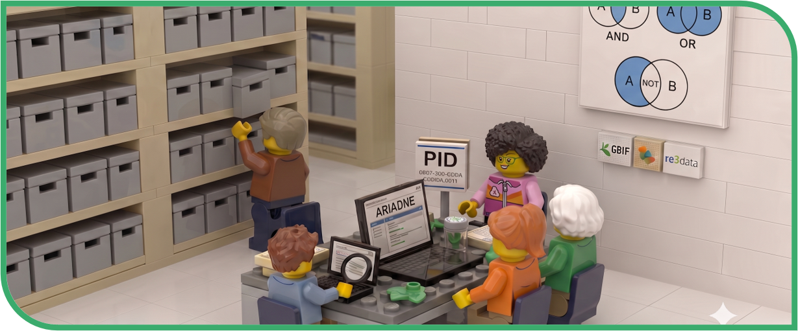

<!--
author:   Dr. Asta von Schröder (DAI) (https://orcid.org/0009-0007-5852-771X) with Anna Lisa Schwartz (GFBio) (https://orcid.org/0000-0003-0391-3879) and Karolin Heinle (MfN)
email:    asta.vonschroeder@dainst.de, alschwartz@gfbio.org, 
version:  0.0.1
version: 1.0
language: en
narrator: English Female
comment: Searching for object-related research data. Part of the series "Research, reuse, and publication of object-related data according to the FAIR principles".
license: CC BY 4.0


link:     https://cdn.jsdelivr.net/chartist.js/latest/chartist.min.css

link:     https://cdn.jsdelivr.net/gh/spaetzuenderin/WiNoDa_L2.4@438c55d/WiNoDa_LiaScript-Style.css

script:   https://cdn.jsdelivr.net/chartist.js/latest/chartist.min.js


@Anita: <div class="persona persona--anita"><span class="persona__image"></span><div>@0</div></div>

@Dave: <div class="persona persona--dave"><span class="persona__image"></span><div>@0</div></div>

@Kai: <div class="persona persona--kai"><span class="persona__image"></span><div>@0</div></div>

@Susan: <div class="persona persona--susan"><span class="persona__image"></span><div>@0</div></div>

@Winnie: <div class="persona persona--winnie"><span class="persona__image"></span><div>@0</div></div>

@AnitaH: <div class="persona persona--anita"><span class="persona__image"></span><div class="persona__heading">@0</div></div>

@DaveH: <div class="persona persona--dave"><span class="persona__image"></span><div class="persona__heading">@0</div></div>

@KaiH: <div class="persona persona--kai"><span class="persona__image"></span><div class="persona__heading">@0</div></div>

@SusanH: <div class="persona persona--susan"><span class="persona__image"></span><div class="persona__heading">@0</div></div>

@WinnieH: <div class="persona persona--winnie"><span class="persona__image"></span><div  class="persona__heading">@0</div></div>

@Anita_: <div class="persona persona--anita"><span class="persona__image"></span><div>@0</div></div>

@Dave_: <div class="persona persona--dave"><span class="persona__image"></span><div>@0</div></div>

@Kai_: <div class="persona persona--kai"><span class="persona__image"></span><div>@0</div></div>

@Susan_: <div class="persona persona--susan"><span class="persona__image"></span><div>@0</div></div>

@Winnie_: <div class="persona persona--winnie"><span class="persona__image"></span><div>@0</div></div>


@ExampleA
<div class="example">
<div class="example__image">


</div>
<div class="exampleA__text">

@0

</div>
</div>
@end

@ExampleB
<div class="example">
<div class="example__image">


</div>
<div class="exampleB__text">

@0

</div>
</div>
@end

@ExampleC
<div class="example">
<div class="example__image">


</div>
<div class="exampleC__text">

@0

</div>
</div>
@end


-->

# About this course
<article>


Welcome and thank you for taking this course on **Searching for object-related research data**.

This course is **part of our series "Research, reuse, and publication of object-related data according to the FAIR principles".**

You will learn how to

- evaluate the research data landscape,
- find object-related data created in archaeology and biodiversity research, as well as in natural history collections
- design and apply successful search strategies to find disciplinary, cross-disciplinary and open research data

**[PLATZHALTER: Estimated time: xx hour]**

## OER
This course was created as Open Educational Resource (OER) and is published under a CC BY licence.

To ensure optimal reusability, we structured the content into modular, self-contained units and chose LiaScript as a format that can be used both within and outside traditional Learning Management Systems (LMS), such as Moodle.

We also aimed to make the course engaging by including interactive material and quizzes throughout, using scenario based questions relevant to our community wherever possible.


>[!NOTE]
>The course series **"Research, reuse, and publication of object-related data according to the FAIR principles"** consists of four parts. You can work through them in any order, but we advise you to begin with "Reusability and its relevance" followed by "Reusing object related research data". The other parts are:
>
>**Reusability and its relevance**
>Learn how to explain the concept of research data reuse, distinguish it from reproduction and replication, and understand why documentation is essential for data reuse.
>
>**Reusing object-related research data**
>Learn about practical requirements for reusing object-related data, such as legal permissions, ethical considerations, persistent identifiers and other Open Science practices.
>
>**Publishing object-related research data**
>Learn about data publication workflows for various domain-specific repositories, submission guidelines and curation support, as well as various tools to assist with publication.

## Navigating the course

**Navigate directly to each portfolio chapter** by clicking on the chapter navigation on the left, or go back and forth between chapters using the arrows in the navigation bars above and below (highlighted in green).

**LiaScript is fully responsive** and can be seen on phones, tablets and any laptop or PC monitor. For the best experience we recommend a (tablet) display of 820×1180 px or more.
</article>
##### Hinweisliste

- **Platzhalter:** „Estimated time: xx hour“ (als [PLATZHALTER: Estimated time: xx hour] markiert). 


# Learning Objectives


<details>
<summary>Learning Objective Matrix on the Topic of Research Data Management (RDM)</summary>

The course creators of WiNoDa Knowledge lab used the **Learning Objective Matrix on the Topic of Research Data Management (RDM)** (from here on: LOM-RDM) as a basis for the creation of OER. 

Learning objectives from the LOM-RDM can be identified by their unique identifier: Subject-ID_Topic-ID-sequential-number.


>Petersen, B., Altemeier, F., Boße, S., Dalby, M., Düvel, N., Engelhardt, C., Fichtner, M., Hastik, C., Haugwitz, J.-M., Jacob, J., Koch, K., Kuntz, A., Manske, A., Mühlichen, A., Murcia Serra, J., Ortmeyer, J., Richter, M., Schranzhofer, H., Slowig, B., … Zollitsch, L. (2025). Learning Objectives Matrix on the Topic of Research Data Management (RDM). Zenodo. https://doi.org/10.5281/zenodo.15846806

</details>

<details>
<summary>WiNoDa specific adaptations</summary>

Where necessary and appropriate, the generic learning objectives of the LOM-RDM were **adapted to fit the specific needs of the WiNoDa community,** i.e. researchers, collection managers and other persons working with object-related data from natural science collections and the history of the Earth and humanity. Adapted learning objectives received a new ID.

New learning objectives have been assigned new IDs following a naming scheme based on the generic LOM-RDM's format, but adding a project identifier at the beginning and enumerating variations of the same with a, b, c at the end like this: WiNoDa_subject-id_topic-id_sequential number-a,b,c.

For example, if an existing learning objective's wording was adapted:

- 04_004_0861 | Learners are able to name different types of repositories.

became

- **WiNoDa**_04_004_0861**a** | Learners are able to name different types of repositories **and aggregators for archaeological data.**
- **WiNoDa**_04_004_0861**b** | Learners are able to name different types of repositories **and aggregators for biodiversity data.**

For completely new learning objectives within an existing topic, the sequential number was counted up, e.g.

- **WiNoDa**_03_003_0677 | **Learners are able to explain the metadata schema ABCD.**

Thus, the generic LOM-RDM remains a stable reference framework for the creation of disciplinary adaptations.


>[PLATZHALTER: XXXX hier unsere LZM zitieren.]

</details>

<details>
<summary>Learning Objectives for this course</summary>

**Chapter 1: Orientation**

- WiNoDa_04_004_0863a | Learners are able to explain the relevance of repositories and aggregators in the research data landscape.
- WiNoDa_04_004_0864a | Learners are able to explain the relevance of repositories and aggregators in research data management (RDM).
- WiNoDa_04_004_0862a | Learners are able to explain differences between different types of repositories and aggregators.
- 04_005_0887 | Learners are able to name various sources of information for searching research data.

**Chapter 2: Finding data**

- WiNoDa_04_004_0861a | Learners are able to name different types of repositories and aggregators for archaeological data.
- WiNoDa_04_004_0865a | Learners are able to name the benefit of different repositories and aggregators for archaeological data.
- WiNoDa_04_004_0861b | Learners are able to name different types of repositories and aggregators for biodiversity data.
- WiNoDa_04_004_0865b | Learners are able to name the benefit of different repositories and aggregators for biodiversity data.
- 01_008_0149 | Learners are able to name platforms for searching open data.

**Chapter 3 - Evaluating platforms**

- WiNoDa_04_004_0866a | Learners are able to evaluate the benefit of different repositories and aggregators for archaeological data.
- WiNoDa_04_004_0866b | Learners are able to evaluate the benefit of different repositories and aggregators for biodiversity data.

**Chapter 4: Search strategies**

- WiNoDa_04_005_0890a | Learners are able to explain different strategies to search.
- 04_005_0890 | Learners are able to evaluate different strategies to search.

**Chapter 5: Persistent identifiers (PIDs)**

- 03_004_0682 | Learners are able to explain the relevance of persistent identifiers.
- WiNoDa_03_004_0683a | Learners are able to apply persistent identifiers for searching archaeological data.
- WiNoDa_03_004_0683b | Learners are able to apply persistent identifiers for searching biodiversity data.
- WiNoDa_03_004_0683c | Learners are able to apply persistent identifiers for searching collection data.

**Chapter 6 - Practical exercises**

- WiNoDa_04_005_0889a | Learners are able to carry out a search for archaeological research data independently.
- WiNoDa_04_004_0873a | Learners are able to carry out a search for archaeological data in a relevant repository independently.
- WiNoDa_04_005_0889b | Learners are able to carry out a search for biodiversity research data independently.
- WiNoDa_04_005_0889c | Learners are able to carry out a search for collection research data independently.
- WiNoDa_04_004_0873b | Learners are able to carry out a search for biodiversity data in a relevant repository independently.
- WiNoDa_04_004_0873c | Learners are able to carry out a search for collection data in a relevant repository independently.
</details>


##### Hinweisliste

- **Platzhalter:**
  - [PLATZHALTER: XXXX hier unsere LZM zitieren.]

- **Korrekturen:**
- geänderte Kapitelüberschriften in Lernzielliste angleichen


# Topic and setting
<article>
## RRP - Searching for object-related research data.

## Our protagonists
Let's introduce our protagonists. Their questions and answers will guide you through this course.

 **Anita** is a graduate student in archaeobotany. She would like to re-use published data - e.g. from museum collections - for her thesis work. Alas, she does not quite know how to go about it.

 **Susan** is a distinguished entomologist and Senior Scientist. Aside from data that she collects herself, she also re-uses collection data and other published datasets for her research. She shares valuable advice on data research with Anita.

 **Winnie** works at the helpdesk of a data competency centre. There is little she doesn't know about finding reusable research data and she is always happy to help with any questions.

 **Kai** works as collection curator at the Natural History Museum. He works on digitising their collections and is interested in making them available for researchers and other interested parties. He tries to keep up to date with the work being done by other museums.

 **Dave**, a Data Scientist at the museum, has a lot of expertise in digital workflows, but the field of natural history collections is still new to him.

Once a week, our protagonists meet at the museum café...
</article>


# 1 - Orientation in the research data landscape

<article>

## Recently, in the cafeteria of the Natural History Museum…


@Anita(```<p>Hi guys! Can I ask you something?</p><p>I really need to find some additional data for my research project, but I am a bit overwhelmed.</p><p>I know how to search literature and how to use a library –</p><p class="persona__heading">but how do I go about searching for data?</p>```)

@Susan_(```<p>That’s an excellent question!</p><p>Just as with literature searches, there are <strong>search strategies for data</strong> too.</p><p>And just as literature can be found in libraries and library catalogues, research data can be found in <strong>repositories and aggregators</strong>.</p><p>Don‘t worry, we can help you.</p>```)

</article>


## 1.1 Repositories and aggregators

@AnitaH(```What are repositories and aggregators?```)

@Winnie_(```<p>Repositories and aggregators are key components of the research data landscape.</p><p>In many disciplines and institutions, increasing amounts of data are created or reused both by institutions and individual researchers or research teams. To ensure that these data can be found, accessed, shared, and reused, they are often deposited in <strong>repositories</strong> and made more easily discoverable through <strong>aggregators</strong>.</p><p>By providing structured metadata, persistent identifiers, and mechanisms for discovery and access, repositories and aggregators contribute to the implementation of the FAIR principles.</p>```)


### 1.1.1 Repositories

@AnitaH(```What is a repository?```)

@Winnie_(```<p>A <strong>repository</strong> is a system that stores and manages digital research outputs, such as datasets, images, 3D models, specimen records, excavation documentation, or publications.</p><p>Repositories are usually operated by universities, research institutions, museums, government agencies, or disciplinary communities. They are responsible for the long-term management and accessibility of the data they hold.</p><p>In addition to storing data, repositories often provide metadata, persistent identifiers, and information about licences and conditions of use.</p>```)

## Bildverzeichnis

| Dateiname | Alt-Text | Caption | Lizenz |
|---|---|---|---|
| `images/file-699888b3b742a.png` | Anita's head in an orange circle. Anita asks | Anita | Nicht angegeben (U); Persona-Bild, daher nicht separat eingebunden |
| `images/file-6a4bcd1fcc57b.png` | Winnie's head in a square frame. Winnie answers | Winnie answers | Nicht angegeben (U); Persona-Bild, daher nicht separat eingebunden |

## Hinweisliste

- **Metadaten nicht angegeben:** Author, Version und Narrator fehlen im Export; ein Logo und eine E-Mail-Adresse sind ebenfalls nicht enthalten.
- **Lizenzangaben:** Die Bildlizenzen sind im Export als „U“ ausgewiesen und nicht näher spezifiziert. Die Kurslizenz wurde gemäß Vorgabe als CC BY 4.0 gesetzt.
- **Platzhalter:** Keine.
- **Fehlende Alt-Texte:** Keine.
- **Unvollständige Texte:** Keine erkennbar.
- **Korrekturen:** Keine vorgenommen.
- **Unklare Persona- oder Stilzuordnungen:** Keine.
- **Quizzes:** Keine vorhanden.


### 1.1.2 Aggregators

@AnitaH(```What is an aggregator?```)

@Winnie_(```<p>An <strong>aggregator</strong> collects metadata from multiple repositories and data providers and makes these records searchable through a single interface.</p><p>Aggregators help users discover relevant data across many collections and institutions.</p><p>They therefore play an important role in improving the visibility and accessibility of research data.</p>```)

## Bildverzeichnis

| Dateiname | Alt-Text | Caption | Lizenz |
|---|---|---|---|
| `images/file-699888b3b742a.png` | Anita's head in an orange circle. Anita asks | Anita | Nicht angegeben (U); Persona-Bild, daher nicht separat eingebunden |
| `images/file-6a4bcd1fcc57b.png` | Winnie's head in a square frame. Winnie answers | Winnie answers | Nicht angegeben (U); Persona-Bild, daher nicht separat eingebunden |

## Hinweisliste

- **Metadaten nicht angegeben:** Author, Version und Narrator fehlen im Export; ein Logo und eine E-Mail-Adresse sind ebenfalls nicht enthalten.
- **Lizenzangaben:** Die Bildlizenzen sind im Export als „U“ ausgewiesen und nicht näher spezifiziert. Die Kurslizenz wurde gemäß Vorgabe als CC BY 4.0 gesetzt.
- **Platzhalter:** Keine.
- **Fehlende Alt-Texte:** Keine.
- **Unvollständige Texte:** Keine erkennbar.
- **Korrekturen:** Keine vorgenommen.
- **Unklare Persona- oder Stilzuordnungen:** Keine.
- **Quizzes:** Keine vorhanden.

<!--
author: not specified
version: not specified
language: en
narrator: not specified
comment: 1.1.3 Repository and aggregator operators
license: CC BY 4.0
-->

### 1.1.3 Repository and aggregator operators

@AnitaH(```Who operates repositories and aggregators and manages access to data?```)

@Winnie_(```<p>Operators may include research organisations, museums, universities, government agencies, disciplinary infrastructures, or international collaborations.</p><p>The organisation responsible for operating each repository or aggregator determines how data are curated, maintained, and made available. Operators also decide which datasets or metadata records are included in their repository or aggregator and how these records are described and indexed.</p><p>Depending on the purpose of the platform and legal or ethical requirements, access to data may be fully open, restricted to specific user groups, or require special permission. For example, sensitive archaeological site information or data concerning endangered species may be subject to access restrictions.</p><p>Understanding who operates a repository or aggregator and how access is managed helps researchers assess whether a platform is suitable for finding, sharing, or reusing research data.</p>```)

<!-- style="color: #AFCA0B; font-family: Arial; font-size: 1.5em;" -->
In a Nutshell:

<!-- style="color: #2581C4" -->
<section>
<strong>Repositories</strong> store and manage research data and metadata.

<strong>Aggregators</strong> bring together metadata from multiple sources and help users discover data across repositories and collections.

Both are essential for making research data visible and reusable.

Different organisations operate repositories and aggregators and may define different access conditions for their data.
</section>

## Bildverzeichnis

| Dateiname | Alt-Text | Caption | Lizenz |
|---|---|---|---|
| `images/file-699888b3b742a.png` | Anita's head in an orange circle. Anita asks | Anita | Nicht angegeben (U); Persona-Bild, daher nicht separat eingebunden |
| `images/file-6a4bcd1fcc57b.png` | Winnie's head in a square frame. Winnie answers | Winnie answers | Nicht angegeben (U); Persona-Bild, daher nicht separat eingebunden |

## Hinweisliste

- **Metadaten nicht angegeben:** Author, Version und Narrator fehlen im Export; ein Logo und eine E-Mail-Adresse sind ebenfalls nicht enthalten.
- **Lizenzangaben:** Die Bildlizenzen sind im Export als „U“ ausgewiesen und nicht näher spezifiziert. Die Kurslizenz wurde gemäß Vorgabe als CC BY 4.0 gesetzt.
- **Platzhalter:** Keine.
- **Fehlende Alt-Texte:** Keine.
- **Unvollständige Texte:** Keine erkennbar.
- **Korrekturen:** Keine vorgenommen.
- **Unklare Persona- oder Stilzuordnungen:** Keine.
- **Quizzes:** Keine vorhanden.


### 1.1.4 Quiz: Repositories and aggregators

<section>

{{1-2}}

<!-- question 1: WiNoDa_04_004_0863a_Multiple-Choice_1 -->
<!-- contentType: Multiple Choice | license: CC BY 4.0 | authors: Asta v. Schröder (ORCID: https://orcid.org/0009-0007-5852-771X) as part of WiNoDa Knowledge Lab | yearFrom: 2026 -->

**Which statement best describes an aggregator?**

<!--
data-randomize
data-text-solved="Correct!"
data-text-failed="Aggregators each store the original research data from a single institution.: This describes a repository, which stores and manages research data rather than aggregating information from multiple sources. | Aggregators assign licences to research data.: Although an aggregator may display licence information, licences are typically assigned by the data provider or repository. | Aggregators replace repositories by storing all research data centrally.: Aggregators usually do not store the original data but help users discover data that remain in repositories or other source systems."
-->
[( )] Aggregators each store the original research data from a single institution.

[(X)] Aggregators collect and provide access to metadata from multiple data sources.

[( )] Aggregators assign licences to research data.

[( )] Aggregators replace repositories by storing all research data centrally.

</section>

<section>

{{2-3}}

<!-- question 2: WiNoDa_04_004_0863a_Multiple-Choice_2 -->
<!-- contentType: Multiple Choice | license: CC BY 4.0 | authors: Asta v. Schröder (ORCID: https://orcid.org/0009-0007-5852-771X) as part of WiNoDa Knowledge Lab | yearFrom: 2026 -->

**Which statement best describes a repository?**

<!--
data-randomize
data-text-solved="Correct!"
data-text-failed="Repositories are a hub for metadata and provide a central search interface.: This describes an aggregator, which helps users discover data from multiple sources rather than storing the data itself. | Repositories only store scientific publications but no actual datasets.: Repositories can store many types of research outputs, including datasets, images, specimen [TEXT UNVOLLSTÄNDIG IN QUELLE] | Repositories automatically make all research data openly accessible without restrictions.: Repositories may provide open or restricted access depending on legal, ethical, institutional, or disciplinary requirements."
-->
[( )] Repositories are a hub for metadata and provide a central search interface.

[(X)] Repositories store, manage, and provide access to research data and related metadata.

[( )] Repositories only store scientific publications but no actual datasets.

[( )] Repositories automatically make all research data openly accessible without restrictions.

</section>

<section>

{{3-4}}

<!-- question 3: WiNoDa_04_004_0863a_Multiple-Choice_3 -->
<!-- contentType: Multiple Choice | license: CC BY 4.0 | authors: Asta v. Schröder (ORCID: https://orcid.org/0009-0007-5852-771X) as part of WiNoDa Knowledge Lab | yearFrom: 2026 -->

**Who is typically responsible for deciding how data are curated, maintained, and made accessible in a repository or aggregator?**

<!--
data-randomize
data-text-solved="Correct!"
data-text-failed="Any researcher who uses the repository or aggregator.: Users can search for and reuse data, but decisions about curation, maintenance, and access are made by the organisation operating the platform. | The software provider that developed the platform.: The software provider may supply the technical infrastructure, but policies for data management and access are set by the organisation running the repository or aggregator. | No one, because all repositories and aggregators must provide unrestricted access to all data.: Access conditions are determined by the operating organisation and may be open, restricted, or require special permission depending on legal, ethical, or disciplinary requirements."
-->
[(X)] The organisation that operates the repository or aggregator.

[( )] Any researcher who uses the repository or aggregator.

[( )] The software provider that developed the platform.

[( )] No one, because all repositories and aggregators must provide unrestricted access to all data.

</section>

### Bilder

- Dateiname: `images/file-699897ee8561b.PNG`
  - Alt-Text: Anita standing under a green question mark
  - Caption: Image unbenannt
  - Lizenz: U

### Hinweise

- **Metadaten fehlen im übermittelten Kapitel:** Version, narrator, comment und logo sind nicht angegeben.
- **Unvollständiger Text:** Feedback zu „Repositories only store scientific publications but no actual datasets.“ endet in der Quelle nach „specimen“.
- **Randomisierung ausgelassen:** keine; die Antwortoptionen sind in allen drei Fragen randomisiert, wie in der Quelle angegeben.
- **Bildzuordnung:** Das Bild ist dem „Anita Quiz“-Platzhalter zugeordnet. Es wurde nicht als separates Kursbild eingesetzt.
- **Korrekturvorschläge:** keine eindeutigen Rechtschreib- oder Grammatikfehler erkannt.


# 1.2 Benefits of repository and aggregators

@AnitaH(```What are the benefits of repositories and aggregators?```)

@Winnie_(```Repositories and aggregators support research data management in different but complementary ways.```)

### Bilder

- Dateiname: `images/file-699888b3b742a.png`
  - Alt-Text: Anita's head in an orange circle. Anita asks
  - Caption: Anita
  - Lizenz: U
- Dateiname: `images/file-6a4bcd1fcc57b.png`
  - Alt-Text: Winnie's head in a square frame. Winnie answers
  - Caption: Winnie answers
  - Lizenz: U

### Hinweise

- Metadaten zu Version, language, narrator, comment und logo sind im übermittelten Kapitel nicht angegeben. `language: en` wurde anhand des englischen Kapitelinhalts gesetzt.
- Die beiden Bilder sind Persona-Bilder und wurden nicht als separate Kursbilder eingesetzt.
- Korrekturvorschlag für den Kapiteltitel: „1.2 Benefits of repositories and aggregators“. Der Originaltitel wurde unverändert übernommen.
- Keine unvollständigen Texte oder unklaren Persona-Zuordnungen erkannt.


### 1.2.1 RDM benefitting from repositories

@AnitaH(```How do repositories contribute to research data management?```)

@Winnie_(```**Repositories** provide a trusted environment for storing, managing, and sharing research data.

Researchers can deposit datasets together with documentation, metadata, and information about methods, licences, or access conditions.

Many repositories require this contextual information as part of their quality assurance procedures. Making contextual information mandatory ensures that data can be reused in different research contexts.

Additionally, many repositories support key RDM requirements by:

- assigning persistent identifiers (such as DOIs),
- enabling long-term preservation,
- documenting provenance and ownership,
- supporting access control where needed,
- facilitating data citation and acknowledgement.

By ensuring that data remain accessible and understandable over time, repositories help researchers comply with institutional, funder, and community requirements.```)

### Bilder

- Dateiname: `images/file-699888b3b742a.png`
  - Alt-Text: Anita's head in an orange circle. Anita asks
  - Caption: Anita
  - Lizenz: U
- Dateiname: `images/file-6a4bcd1fcc57b.png`
  - Alt-Text: Winnie's head in a square frame. Winnie answers
  - Caption: Winnie answers
  - Lizenz: U

### Hinweise

- Metadaten zu Version, narrator, comment und logo sind im übermittelten Kapitel nicht angegeben.
- Die Bilder sind Persona-Bilder und wurden nicht als separate Kursbilder eingesetzt.
- Keine Platzhalter, fehlenden Alt-Texte, unvollständigen Texte, Korrekturvorschläge oder unklaren Zuordnungen erkannt.


### 1.2.2 RDM benefitting from aggregators

@AnitaH(```How do aggregators contribute to research data management?```)

@Winnie_(```**Aggregators** collect and combine metadata from multiple repositories and data providers, thus increasing the visibility of research outputs and helping connect datasets that would otherwise remain difficult to find.

For researchers, aggregators reduce the effort required to search across many individual repositories.

For data providers, they broaden the reach of their collections without requiring duplicate data storage.```)

### Bilder

- Dateiname: `images/file-699888b3b742a.png`
  - Alt-Text: Anita's head in an orange circle. Anita asks
  - Caption: Anita
  - Lizenz: U
- Dateiname: `images/file-6a4bcd1fcc57b.png`
  - Alt-Text: Winnie's head in a square frame. Winnie answers
  - Caption: Winnie answers
  - Lizenz: U

### Hinweise

- Metadaten zu Version, narrator, comment und logo sind im übermittelten Kapitel nicht angegeben.
- Die Bilder sind Persona-Bilder und wurden nicht als separate Kursbilder eingesetzt.
- Keine Platzhalter, fehlenden Alt-Texte, unvollständigen Texte, Korrekturvorschläge oder unklaren Zuordnungen erkannt.


### 1.2.3 FAIR data benefitting from repositories and aggregators

@AnitaH(```How do repositories and aggregators support the FAIR principles?```)

@Winnie_(```Repositories and aggregators both contribute to making data more **Findable, Accessible, Interoperable, and Reusable (FAIR)**, but in different ways.

**Repositories** support FAIRness by

- preserving data,
- managing metadata,
- assigning persistent identifiers,
- using and enforcing community standards where appropriate, and
- providing access mechanisms.

**Aggregators** strengthen FAIRness by

- increasing discoverability,
- connecting metadata from multiple sources, and
- enabling cross-collection searches.```)

<!-- style="color: #AFCA0B; font-family: Arial; font-size: 1.5em;" -->
In a Nutshell:

<!-- style="color: #2581C4" -->
<section>
A repository without aggregation may be difficult for potential users to find.

An aggregator without repositories would have no data sources to connect.

Together, they help ensure that research data can be located, understood, accessed, and reused by different communities.

Thus, they form an essential part of the infrastructure that enables effective research data management and data reuse.
</section>

### Bilder

- Dateiname: `images/file-699888b3b742a.png`
  - Alt-Text: Anita's head in an orange circle. Anita asks
  - Caption: Anita
  - Lizenz: U
- Dateiname: `images/file-6a4bcd1fcc57b.png`
  - Alt-Text: Winnie's head in a square frame. Winnie answers
  - Caption: Winnie answers
  - Lizenz: U

### Hinweise

- Metadaten zu Version, narrator, comment und logo sind im übermittelten Kapitel nicht angegeben.
- Die Bilder sind Persona-Bilder und wurden nicht als separate Kursbilder eingesetzt.
- Unklare Zuordnungen: keine.
- Keine Platzhalter, fehlenden Alt-Texte, unvollständigen Texte oder Korrekturvorschläge erkannt.


### 1.2.4 Quiz: Repositories and aggregator benefits


<!-- Bildlizenz: U (nicht näher angegeben) -->

<section>

<!-- question 1: WiNoDa_04_004_0864a_Single-Choice-Set -->
<!-- license: CC BY 4.0 | authors: Asta v. Schröder (ORCID: https://orcid.org/0009-0007-5852-771X) as part of WiNoDa Knowledge Lab | yearFrom: 2026 | contentType: Single Choice Set -->

{{1-2}}

**A researcher deposits a dataset and receives a DOI.**

[(X)] Repository

[( )] Aggregator

[( )] both

</section>

<section>

<!-- question 2: WiNoDa_04_004_0864a_Single-Choice-Set -->
<!-- license: CC BY 4.0 | authors: Asta v. Schröder (ORCID: https://orcid.org/0009-0007-5852-771X) as part of WiNoDa Knowledge Lab | yearFrom: 2026 | contentType: Single Choice Set -->

{{2-3}}

**A user searches millions of biodiversity records from hundreds of institutions through one portal.**

[(X)] Aggregator

[( )] Repository

[( )] both

</section>

<section>

<!-- question 3: WiNoDa_04_004_0864a_Single-Choice-Set -->
<!-- license: CC BY 4.0 | authors: Asta v. Schröder (ORCID: https://orcid.org/0009-0007-5852-771X) as part of WiNoDa Knowledge Lab | yearFrom: 2026 | contentType: Single Choice Set -->

{{3-4}}

**Metadata are harvested from many collections.**

[(X)] Aggregator

[( )] Repository

[( )] both

</section>

<section>

<!-- question 4: WiNoDa_04_004_0864a_Single-Choice-Set -->
<!-- license: CC BY 4.0 | authors: Asta v. Schröder (ORCID: https://orcid.org/0009-0007-5852-771X) as part of WiNoDa Knowledge Lab | yearFrom: 2026 | contentType: Single Choice Set -->

{{4-5}}

**Data are preserved for long-term access.**

[(X)] Repository

[( )] Aggregator

[( )] both

</section>

<section>

<!-- question 5: WiNoDa_04_004_0864a_Single-Choice-Set -->
<!-- license: CC BY 4.0 | authors: Asta v. Schröder (ORCID: https://orcid.org/0009-0007-5852-771X) as part of WiNoDa Knowledge Lab | yearFrom: 2026 | contentType: Single Choice Set -->

{{5-6}}

**A dataset becomes easier for researchers worldwide to discover.**

[(X)] both

[( )] Repository

[( )] Aggregator

</section>

<section>

<!-- question 6: WiNoDa_04_004_0864a_Single-Choice-Set -->
<!-- license: CC BY 4.0 | authors: Asta v. Schröder (ORCID: https://orcid.org/0009-0007-5852-771X) as part of WiNoDa Knowledge Lab | yearFrom: 2026 | contentType: Single Choice Set -->

{{6}}

**FAIR data practices are supported.**

[(X)] both

[( )] Repository

[( )] Aggregator

</section>

### Bilder

| Dateiname | Alt-Text | Caption | Lizenz |
|---|---|---|---|
| `images/file-699897ee8561b.PNG` | Anita standing under a green question mark | Image unbenannt | U (nicht näher angegeben) |

### Hinweise

- Platzhalter: author, version, language-unabhängige Header-Felder email, narrator, comment und logo sowie die Lizenzangabe zum Bild sind in der Quelle nicht angegeben. „U“ wurde als nicht näher angegebene Lizenz übernommen.
- Unklare Quiz-Zuordnung: Die Quelle enthält keinen separaten Titel oder Feedback pro Frage; der gemeinsame Quiz-Titel und die gemeinsamen Metadaten wurden für alle sechs Fragen verwendet.
- Randomisierung: `data-randomize` wurde ausgelassen, da die Quelle keine Randomisierung angibt.
- Die vorliegende Quelle enthält keine Angaben zu weiteren Kapitelüberschriften oder Korrekturvorschlägen.


## 1.3 Types of repositories and aggregators

@AnitaH(```Are there different types of repositories or aggregators?```)

@Winnie_(```<p>Yes.</p><p><strong>Repositories and aggregators differ in their scope, purpose, and the communities they serve.</strong></p><p>This diversity reflects the different needs of research communities. A biodiversity researcher may require specialised standards and search functions that differ from those needed in archaeology or museum documentation. At the same time, researchers often need to discover data beyond their own discipline.</p>```)

### Bilder

Persona-Bilder werden entsprechend den Vorgaben durch Makros ersetzt und nicht separat eingebunden.

| Dateiname | Alt-Text | Caption | Lizenz |
|---|---|---|---|
| `images/file-699888b3b742a.png` | Anita's head in an orange circle. Anita asks | Anita | U (nicht näher angegeben) |
| `images/file-6a4bcd1fcc57b.png` | Winnie's head in a square frame. Winnie answers | Winnie answers | U (nicht näher angegeben) |

### Hinweise

- Platzhalter: author, version, email, narrator, comment und logo sind in der Quelle nicht angegeben. Die Lizenz des Kurses wurde gemäß Vorgabe als CC BY 4.0 gesetzt.
- Die Bildlizenzen sind in der Quelle mit „U“ angegeben und daher nicht näher bestimmbar.
- Keine offensichtlichen Tippfehler oder unklaren Persona-Zuordnungen erkannt.

<!--
author: [PLATZHALTER: nicht angegeben]
email:
version: [PLATZHALTER: nicht angegeben]
language: en
narrator:
comment:
logo:
license: CC BY 4.0
-->

### 1.3.1 Repository types

@AnitaH(```What types of repositories are there?```)

@Winnie_(```Repositories can be classified according to the organisation that maintains them, the community they serve, or the purpose for which they were created.<br>Some are designed for a specific discipline, while others accept data from many research fields. They may also be operated by different types of organisations, such as research institutions, museums, universities, or international infrastructures.<br>Common types of repositories include:

- **Institutional repositories**, which are maintained by a specific organisation and often serve its researchers and collections e.g. [iDAI.repo](https://repo.dainst.org/) (DAI - German Archaeological Institute), ~~[GFBio submissions](https://submissions.gfbio.org/) (German Federation for Biological Data),~~ [Tierstimmenarchiv](https://suche.tierstimmenarchiv.de/?language=english) (MfN - Museum für Naturkunde Berlin ).
- **Disciplinary repositories**, which focus on a particular research domain and often use community-specific standards, e.g. [iDAI.objects/arachne](https://arachne.dainst.org/) (archaeology), [PANGAEA](https://www.pangaea.de/) (earth and environmental sciences), or [Dryad](https://datadryad.org/) (life sciences).
- **General-purpose repositories**, which accept data from many disciplines and research areas, e.g. [Zenodo](https://zenodo.org/).
- **Project repositories**, which are created for a specific project or initiative and may have a limited lifespan. They are often hosted on institutional servers or deposited in broader infrastructures such as [Zenodo](https://zenodo.org/search?q=project%20data&f=access\_status%3Aopen&f=resource\_type%3Adataset&f=subject%3ABiodiversity&f=publication\_date%3A2025-12-18..2026-06-18&l=list&p=1&s=10&sort=bestmatch)). Project-related software, documentation, and occasionally data, may also be shared through platforms such as [GitHub](https://github.com/dainst/Olympia-Excavation-Diaries)).
```)

Note
----

These categories are not mutually exclusive. Many institutional repositories also focus on a particular discipline, and many disciplinary repositories are maintained by specific institutions.<br>At the same time, different repository types can coexist within the same research workflow.<br>For example, a museum may manage collection data in an institutional repository while also contributing data to a disciplinary repository used by a broader research community.

### Bilder

Persona-Bilder werden entsprechend den Vorgaben durch Makros ersetzt und nicht separat eingebunden.

| Dateiname | Alt-Text | Caption | Lizenz |
|---|---|---|---|
| `images/file-699888b3b742a.png` | Anita's head in an orange circle. Anita asks | Anita | U (nicht näher angegeben) |
| `images/file-6a4bcd1fcc57b.png` | Winnie's head in a square frame. Winnie answers | Winnie answers | U (nicht näher angegeben) |

### Hinweise

- Platzhalter: author, version, email, narrator, comment und logo sind in der Quelle nicht angegeben. Die Kurslizenz wurde gemäß Vorgabe als CC BY 4.0 gesetzt.
- Bildlizenzen sind in der Quelle mit „U“ angegeben und nicht näher bestimmbar.
- Mögliche Korrekturvorschläge, unverändert im Kurstext belassen: „collections e.g.“ könnte eine Zeichensetzung vor „e.g.“ benötigen; in „Museum für Naturkunde Berlin ).“ steht ein Leerzeichen vor der schließenden Klammer; im Projekt-Repositories-Abschnitt erscheinen zusätzliche schließende Klammern nach den Zenodo- und GitHub-Links.
- Persona-Zuordnung: Die Frage ist Anita, die Erklärung Winnie zugeordnet.

<!--
author: [PLATZHALTER: nicht angegeben]
email:
version:
language: en
narrator:
comment:
logo:
license: CC BY 4.0
-->

### 1.3.2 Aggregator types

@AnitaH(```What types of aggregators are there?```)

@Winnie_(```Some aggregators focus on a particular discipline, while others combine information from many research domains. They may also operate at national, regional, or international levels.

Common types of aggregators include:

- **Disciplinary aggregators**, which bring together information from a specific research field, e.g. [Ariadne](https://www.ariadne-research-infrastructure.eu/) for archaeology or [GBIF](https://www.gbif.org/) for biodiversity data.
- **Cross-disciplinary aggregators**, which allow users to search across multiple research domains, e.g. [OpenAIRE](https://www.openaire.eu/), [DataCite Commons](https://commons.datacite.org/).
- **Thematic aggregators**, which focus on a particular topic, resource type, or community, e.g. [Europeana](https://www.europeana.eu/en) for European cultural heritage.

Aggregators can also differ in their geographic scope. Some operate at regional or national levels, while others connect data providers across multiple countries or even worldwide.<br>By bringing together metadata from multiple sources, aggregators enable users to discover relevant data through a single search interface. Although aggregators may differ in scope, they share the common goal of improving the discoverability of research data and collections.```)

<!-- style="color: #AFCA0B; font-family: Arial; font-size: 1.5em;" -->
In a Nutshell:

<!-- style="color: #2581C4" -->
<section>
Repositories and aggregators can be classified according to their scope, purpose, the communities they serve, and the organisations that maintain them.

- Repositories may be institutional, disciplinary, general-purpose, or project-based.
- Aggregators may be disciplinary, cross-disciplinary, thematic, regional, or international.

Understanding these different types helps researchers identify suitable places to deposit data and effective tools for finding existing data.
</section>

### Bilder

Persona-Bilder werden entsprechend den Vorgaben durch Makros ersetzt und nicht separat eingebunden.

| Dateiname | Alt-Text | Caption | Lizenz |
|---|---|---|---|
| `images/file-699888b3b742a.png` | Anita's head in an orange circle. Anita asks | Anita | U (nicht näher angegeben) |
| `images/file-6a4bcd1fcc57b.png` | Winnie's head in a square frame. Winnie answers | Winnie answers | U (nicht näher angegeben) |

### Hinweise

- Platzhalter: author, version, email, narrator, comment und logo sind in der Quelle nicht angegeben. Die Kurslizenz wurde gemäß Vorgabe als CC BY 4.0 gesetzt.
- Bildlizenzen sind in der Quelle mit „U“ angegeben und nicht näher bestimmbar.
- Keine offensichtlichen Tippfehler oder unklaren Persona- und Stilzuordnungen erkannt.


<!--
author: Asta v. Schröder (WiNoDa Knowledge Lab)
version: 1.0.0
language: en
narrator: UK English Female
comment: 1.3.3 Quiz: Repository types
license: CC BY 4.0
-->

### 1.3.3 Quiz: Repository types


<!-- Image license: U -->

<!-- Quiz: L2.2_1.3.3_Quiz -->
<!-- license: CC BY 4.0 | authors: Asta v. Schröder (ORCID: https://orcid.org/0009-0007-5852-771X) as part of WiNoDa Knowledge Lab | yearFrom: 2026 | contentType: Question Set -->

{{1}}
<section>

<!-- question 1: WiNoDa_04_004_0862a_Multiple-Choice_1 -->
<!-- license: CC BY 4.0 | authors: Asta v. Schröder (ORCID: https://orcid.org/0009-0007-5852-771X) as part of WiNoDa Knowledge Lab | yearFrom: 2026 | contentType: Multiple Choice -->

**Why do different types of repositories and aggregators exist?**

<!--
data-randomize
data-text-solved="Correct. Different disciplines and communities require different standards, services, and discovery tools."
data-text-failed="Because every institution wants to use their own branding and metadata.: No. While institutions may have their own branding and metadata practices, this is not the main reason different repository and aggregator types exist.
Because every country requires its own repository.: No. Repositories and aggregators can operate at local, national, regional, or international levels.
Because each data type can only be stored in one format, so we need different repositories for each data type.: No. Most repositories can store multiple file formats."
-->

[(X)] Because research communities have different needs.

[( )] Because every institution wants to use their own branding and metadata.

[( )] Because every country requires its own repository.

[( )] Because each data type can only be stored in one format, so we need different repositories for each data type.

***
Different research communities have different requirements for managing and discovering data.
***

</section>

{{2}}
<section>

<!-- question 2: WiNoDa_04_004_0862a_Multiple-Choice_2 -->
<!-- license: CC BY 4.0 | authors: Asta v. Schröder (ORCID: https://orcid.org/0009-0007-5852-771X) as part of WiNoDa Knowledge Lab | yearFrom: 2026 | contentType: Multiple Choice -->

**Which statement is correct?**

<!--
data-randomize
data-text-solved="Correct — many repositories are maintained by a specific institution while also serving a particular research discipline."
data-text-failed="Institutional and disciplinary repositories are always different categories.: A repository may be both institutional and disciplinary.
A repository can only belong to one category.: Repository categories are not mutually exclusive, and a repository may fit more than one category.
General-purpose repositories are actually aggregators.: General-purpose repositories store and provide access to data, whereas aggregators primarily help users discover data from multiple sources."
-->

[( )] Institutional and disciplinary repositories are always different categories.

[( )] A repository can only belong to one category.

[(X)] Institutional and disciplinary repositories may overlap.

[( )] General-purpose repositories are actually aggregators.

***
Repository types are not always distinct categories; understanding that repositories can serve multiple roles helps researchers choose appropriate places to deposit and discover data.
***

</section>

{{3}}
<section>

<!-- question 3: WiNoDa_04_004_0862a_Multiple-Choice_3 -->
<!-- license: CC BY 4.0 | authors: Asta v. Schröder (ORCID: https://orcid.org/0009-0007-5852-771X) as part of WiNoDa Knowledge Lab | yearFrom: 2026 | contentType: Multiple Choice -->

**A museum stores its collection data in its own repository and also contributes metadata to GBIF. Which statement best describes this situation?**

<!--
data-randomize
-->

[( )] The museum uses only one repository.

[(X)] The museum uses both an institutional repository and a disciplinary aggregator.

[( )] GBIF stores all original museum data.

[( )] Institutional repositories cannot contribute to aggregators.

</section>

{{4}}
<section>

<!-- question 4: WiNoDa_04_004_0862a_Drag-the-Words -->
<!-- license: CC BY 4.0 | authors: Asta v. Schröder (ORCID: https://orcid.org/0009-0007-5852-771X) as part of WiNoDa Knowledge Lab | yearFrom: 2026 | contentType: Drag the Words -->

Match the examples to the most appropriate category by dropping the words into the correct boxes.

| Example | Category |
|---|---|
| *Zenodo* | [[ (General-purpose repository) | Institutional repository | Disciplinary repository | Disciplinary aggregator | Cross-disciplinary aggregator | Thematic aggregator ]] |
| *iDAI.repo* | [[ (Institutional repository) | General-purpose repository | Disciplinary repository | Disciplinary aggregator | Cross-disciplinary aggregator | Thematic aggregator ]] |
| *PANGAEA* | [[ (Disciplinary repository) | General-purpose repository | Institutional repository | Disciplinary aggregator | Cross-disciplinary aggregator | Thematic aggregator ]] |
| *GBIF* | [[ (Disciplinary aggregator) | General-purpose repository | Institutional repository | Disciplinary repository | Cross-disciplinary aggregator | Thematic aggregator ]] |
| *OpenAIRE* | [[ (Cross-disciplinary aggregator) | General-purpose repository | Institutional repository | Disciplinary repository | Disciplinary aggregator | Thematic aggregator ]] |
| *Europeana* | [[ (Thematic aggregator) | General-purpose repository | Institutional repository | Disciplinary repository | Disciplinary aggregator | Cross-disciplinary aggregator ]] |

</section>

---

## Hinweisliste

- **Kapitelnummerierung:** Kapitelüberschrift als `###` umgesetzt, entsprechend der vorgegebenen Nummerierung.
- **Bildlizenz:** Für Anita ist im Quelldatensatz die Lizenz `U` angegeben. Eine genauere Lizenzbezeichnung fehlt.
- **Quiz 1–3:** Randomisierung übernommen (`randomAnswers: true`).
- **Quiz 4:** Keine Randomisierung übernommen. Die sechs Zuordnungen sind fest miteinander verknüpft; eine zufällige Reihenfolge der Antwortmöglichkeiten wurde nicht ausdrücklich aus der Quelle vorgegeben.
- **Quiz 3:** Kein individuelles Feedback und kein Gesamtfeedback in der Quelle vorhanden.
- **Quiz 4:** Kein Gesamtfeedback in der Quelle vorhanden.
- **Persona-Zuordnung:** Das Bild zeigt Anita, enthält aber keinen Persona-Fragetext. Daher wurde kein Persona-Makro anstelle eines Fragetextes eingesetzt.
- **Metadaten:** Die Kurslizenz wurde entsprechend deiner Vorgabe auf CC BY 4.0 gesetzt. Die Quiz-Metadaten wurden separat übernommen.
- **Korrekturvorschläge:** Keine offensichtlichen Rechtschreib- oder Grammatikfehler festgestellt.
- **Platzhalter / unvollständige Texte:** Keine festgestellt.

## Bildverzeichnis

| Dateiname | Alt-Text | Caption | Lizenz |
|---|---|---|---|
| `images/file-699897ee8561b.PNG` | Anita standing under a green question mark | Image unbenannt | U |


<!--
author: Asta v. Schröder (WiNoDa Knowledge Lab)
version: 1.0.0
language: en
narrator: UK English Female
comment: 1.4 Portals and Platforms
license: CC BY 4.0
-->

# 1.4 Portals and Platforms


<!-- Image license: U -->

<!-- style="color: #AFCA0B; font-family: Arial; font-size: 1.5em;" -->
In a Nutshell:

<section>

<!-- style="color: #2581C4" -->
<section>

**Good to know**

When searching for data, we often told to use a "**platform**" or "**portal**" instead of an "aggregator" or "repository". These terms primarily describe how users access a service and therefore tell you less about its underlying technical function.

</section>

=== Portals

A **portal** may:

- search one repository,
- search many repositories,
- provide additional services,
- act as an aggregator interface.

In practice, many aggregators are accessed through a portal.

**For example,** the ARIADNE Portal serves as the user interface through which users access the ARIADNE infrastructure and its aggregated resources.

=== Platforms

A **platform** can be:

- a repository,
- an aggregator,
- a portal,
- or a combination of these.

In fact, "platform" is the broadest and least precise term, as it does not by itself indicate whether the service is a repository, an aggregator, a portal, or a combination of these.

**For example,** Zenodo, GBIF and OpenAIRE are often called platforms.

<!-- style="color: #AFCA0B; font-family: Arial; font-size: 1.5em;" -->
In a Nutshell:

<!-- style="color: #2581C4" -->
<section>

- **Repository**, **aggregator**, and **repository registry** describe a service's function.
- **Portal** usually refers to the user interface through which a service is accessed.
- **Platform** is a broad, generic term that may refer to many different kinds of data infrastructure.

</section>

---

## Hinweisliste

- **Platzhalter:** Keine.
- **Fehlende Alt-Texte:** Keine.
- **Unvollständige Texte:** Keine.
- **Korrekturvorschlag:** „When searching for data, we often told to use ...“ – grammatikalisch fehlt vermutlich „are“ oder „are told“. Original unverändert übernommen.
- **Persona-Zuordnung:** Winnie ist durch das Bild eindeutig zugeordnet. Der Informationstext wurde nicht als Persona-Makro ausgegeben, da er keine direkte Frage oder Antwort im Sinne der Makroregeln enthält.
- **Stilzuordnung:** „Good to know“ wurde als lokale Zwischenüberschrift behandelt. „Portals“ und „Platforms“ ebenfalls, damit sie nicht als eigenständige Kapitelüberschriften im Inhaltsverzeichnis erscheinen.
- **In a Nutshell:** Beide Vorkommen wurden entsprechend den vorgegebenen Formatierungsregeln umgesetzt.
- **Randomisierung:** Nicht relevant (kein Quiz).

## Bildverzeichnis

| Dateiname | Alt-Text | Caption | Lizenz |
|---|---|---|---|
| `images/file-69989c72f2355.PNG` | Winnie sitting behind a blue desk with a lime-green telephone, holding the receiver. Above her is a large "i" in a circle | Winnie | U |


### 1.4.1 Example search: Archaeology


<!-- Image license: U -->

<!-- style="color: #AFCA0B; font-family: Arial; font-size: 1.5em;" -->
Disciplinary search - Archaeology

Anita is searching for archaeobotanical datasets to compare with material from her own research project.

She begins with repositories and data portals maintained by her university and project partners because she is already familiar with these resources and their data standards.

To identify additional datasets beyond her immediate network, she expands her search to the ARIADNE Portal, which provides access to archaeological resources from many institutions and countries.

When she finds references to relevant datasets, she follows links to the repositories where the data are stored and documented in more detail.

Starting locally and then broadening the search helps her find both familiar and previously unknown sources of data.

---

## Hinweisliste

- **Platzhalter:** Keine.
- **Fehlende Alt-Texte:** Keine.
- **Unvollständige Texte:** Keine.
- **Korrekturvorschläge:** Keine offensichtlichen Tipp- oder Grammatikfehler festgestellt.
- **Persona-Zuordnung:** Anita ist durch das Bild und den Text eindeutig zugeordnet. Der Text ist eine Erzählung über Anita, keine direkte Frage oder Antwort. Daher kein Persona-Makro.
- **Stilzuordnung:** „Disciplinary search - Archaeology“ wurde als lokale Zwischenüberschrift umgesetzt.
- **Randomisierung:** Nicht relevant (kein Quiz).

## Bildverzeichnis

| Dateiname | Alt-Text | Caption | Lizenz |
|---|---|---|---|
| `images/file-69eb204d9b2c3.PNG` | Anita standing under a green magnifying glass | Image unbenannt | U |


<!--
author: Asta v. Schröder (WiNoDa Knowledge Lab)
version: 1.0.0
language: en
narrator: UK English Female
comment: 1.4.2 Example search: Biodiversity
license: CC BY 4.0
-->

### 1.4.2 Example search: Biodiversity


<!-- Image license: U -->

<!-- style="color: #AFCA0B; font-family: Arial; font-size: 1.5em;" -->
Example search - Biodiversity

Susan is looking for occurrence records of dragonfly species across Europe.

Because she needs biodiversity data from many institutions and countries, she starts with a disciplinary aggregator such as GBIF. This allows her to search millions of records through a single interface.

Once she identifies particularly relevant datasets, she visits the original repositories or collection portals for additional information.

Starting with a disciplinary aggregator allows Susan to search broadly across many institutions before focusing on the most relevant datasets and their original sources.

---

## Hinweisliste

- **Platzhalter:** Keine.
- **Fehlende Alt-Texte:** Keine.
- **Unvollständige Texte:** Keine.
- **Korrekturvorschläge:** Keine offensichtlichen Tipp- oder Grammatikfehler festgestellt.
- **Persona-Zuordnung:** Susan ist durch das Bild und den Text eindeutig zugeordnet. Da es sich um eine Erzählung und nicht um eine direkte Frage oder Antwort handelt, wurde kein Persona-Makro verwendet.
- **Stilzuordnung:** „Example search - Biodiversity“ wurde als lokale Zwischenüberschrift umgesetzt.
- **Randomisierung:** Nicht relevant (kein Quiz).

## Bildverzeichnis

| Dateiname | Alt-Text | Caption | Lizenz |
|---|---|---|---|
| `images/file-69eb2086bf569.PNG` | Susan standing under a green magnifying glass | Image unbenannt | U |


<!--
author: Asta v. Schröder (WiNoDa Knowledge Lab)
version: 1.0.0
language: en
narrator: UK English Female
comment: 1.4.3 Example search: Collection Management
license: CC BY 4.0
-->

### 1.4.3 Example search: Collection Management


<!-- Image license: U -->

<!-- style="color: #AFCA0B; font-family: Arial; font-size: 1.5em;" -->
Example search – Collection Management

Kai is looking for examples of how other institutions publish collection data and metadata.

Because he does not yet know which repositories are commonly used by natural history museums or which infrastructures support collection data, he starts with a repository registry such as re3data. The registry helps him identify repositories and infrastructures commonly used for collection data.

He then explores specific institutional repositories and aggregators to compare their services and data standards.

Starting with a repository registry helps Kai gain an overview of the available infrastructure before exploring individual repositories and aggregators in more detail.

---

## Hinweisliste

- **Platzhalter:** Keine.
- **Fehlende Alt-Texte:** Keine.
- **Unvollständige Texte:** Keine.
- **Korrekturvorschläge:** Keine offensichtlichen Tipp- oder Grammatikfehler festgestellt.
- **Persona-Zuordnung:** Kai ist durch das Bild und den Text eindeutig zugeordnet. Der Text ist eine Erzählung, keine direkte Frage oder Antwort. Daher kein Persona-Makro.
- **Stilzuordnung:** „Example search – Collection Management“ wurde als lokale Zwischenüberschrift umgesetzt.
- **Randomisierung:** Nicht relevant (kein Quiz).

## Bildverzeichnis

| Dateiname | Alt-Text | Caption | Lizenz |
|---|---|---|---|
| `images/file-69eb20b57cd8d.PNG` | Kai standing under a green magnifying glass | Image unbenannt | U |


### 1.4.4 Quiz: Data sources


<!-- Image license: U -->

<!-- Quiz: 04_005_0887_Single-Choice-Set -->
<!-- license: CC BY 4.0 | authors: Asta v. Schröder (ORCID: https://orcid.org/0009-0007-5852-771X) as part of WiNoDa Knowledge Lab | yearFrom: 2026 | contentType: Single Choice Set -->

{{1}}
<section>

**Which of the following is a common source for finding research data?**

[(X)] Repository

[( )] Textbook

[( )] Social media profile

</section>

{{2}}
<section>

**What is the role of an aggregator?**

[(X)] Collect metadata from multiple sources and support discovery

[( )] Replace repositories

[( )] Assign DOIs to every dataset

</section>

{{3}}
<section>

**Why is it often useful to search multiple sources?**

[(X)] Because different sources may contain different datasets

[( )] Because repositories can store only one dataset at a time

[( )] Aggregators are always incomplete

</section>

{{4}}
<section>

**Research data can only be found in repositories.**

[( )] True

[(X)] False

</section>

---

## Hinweisliste

- **Platzhalter:** Keine.
- **Fehlende Alt-Texte:** Keine.
- **Unvollständige Texte:** Keine.
- **Korrekturvorschläge:** Keine offensichtlichen Tipp- oder Grammatikfehler festgestellt.
- **Persona-Zuordnung:** Anita ist durch das Bild eindeutig zugeordnet. Die Quizfragen sind nicht als Persona-Text gekennzeichnet. Daher keine Persona-Makros.
- **Quizformat:** Single Choice Set mit vier Fragen; alle Fragen wurden in der vorgegebenen Reihenfolge übernommen.
- **Randomisierung:** Nicht übernommen. Die Quelle enthält keine explizite Konfiguration zur zufälligen Antwortreihenfolge.
- **Feedback:** Keine individuellen Feedbacktexte und kein Gesamtfeedback in der Quelle vorhanden.
- **Hinweise:** Keine Tipps in der Quelle vorhanden.

## Bildverzeichnis

| Dateiname | Alt-Text | Caption | Lizenz |
|---|---|---|---|
| `images/file-699897ee8561b.PNG` | Anita standing under a green question mark | Image unbenannt | U |


<!--
author: Asta v. Schröder (WiNoDa Knowledge Lab)
version: 1.0.0
language: en
narrator: UK English Female
comment: 2 – Where to find data
license: CC BY 4.0
-->

# 2 – Where to find data


@AnitaH(```Where do I start my search for research data?```)


@Susan_(```As we have already seen, you can find research data through many different sources.

You can start with institutional or disciplinary repositories, aggregators, or research portals. Some focus on specific disciplines, while others cover multiple research domains. They may also operate at regional, national, or international levels.

If you don't yet know the infrastructure for a certain field, you can use an additional source: **repository registries like re3data**. These services do neither store nor aggregate research data. Instead, they help users identify suitable repositories and infrastructures.

In short:

**Repository → stores data**

**Aggregator → helps find data**

**Repository registry → helps find repositories**

But there is no universally correct starting point for finding research data.

The most effective starting point for you specifically depends on your research question and the type of data you are looking for.```)

<!-- style="color: #AFCA0B; font-family: Arial; font-size: 1.5em;" -->
In a Nutshell:

<!-- style="color: #2581C4" -->
<section>

Effective data searches often combine multiple sources and may start at different points, depending on the research question.

Common starting points for finding research data include:

- Institutional repositories
- Disciplinary repositories
- Aggregators
- Research portals
- Repository registries (e.g. re3data)

</section>

---

## Hinweisliste

- **Platzhalter:** Keine.
- **Fehlende Alt-Texte:** Keine.
- **Unvollständige Texte:** Keine.
- **Korrekturvorschläge:**
  - „These services do neither store nor aggregate research data.“ – mögliche grammatikalische Korrektur: „These services neither store nor aggregate research data.“ Original unverändert übernommen.
- **Persona-Zuordnung:**
  - Anita Question → `@AnitaH` (eindeutig).
  - Susan Answer / Explanation → `@Susan_` (eindeutig).
- **Stilzuordnung:**
  - „In a Nutshell“ wurde entsprechend den vorgegebenen Formatierungsregeln umgesetzt.
  - Die Kapitelüberschrift wurde als Hauptüberschrift `#` übernommen.
- **Randomisierung:** Nicht relevant (kein Quiz).

## Bildverzeichnis

| Dateiname | Alt-Text | Caption | Lizenz |
|---|---|---|---|
| `images/file-699888b3b742a.png` | Anita's head in an orange circle. Anita asks | Anita | U |
| `images/file-6a719c313afe6.png` | Susan, Kai, Winnie, Anita and Dave sitting around a table with mugs and pastries. | Image Unbenannt | U |
| `images/file-69989fc2600f2.png` | Susan's head in a square frame. Susan explains | Susan explains | U |


<!--
author: Asta v. Schröder (WiNoDa Knowledge Lab)
version: 1.0.0
language: en
narrator: UK English Female
comment: 2.1 Data sources - general
license: CC BY 4.0
-->

## 2.1 Data sources - general


@AnitaH(```What sources can I use to find object-related data?```)


@Winnie_(```Research data can be discovered through

- repositories,
- aggregators,
- literature databases,
- knowledge graphs, and
- cross-disciplinary research infrastructures.

**The choice of tools depends on your search needs.**

In the following pages we will talk about the most common sources for archaeology data research and their benefits.```)

<!-- style="color: #AFCA0B; font-family: Arial; font-size: 1.5em;" -->
Note:

<!-- style="color: #2581C4" -->
<section>

The categories in this table are not mutually exclusive. Some services fulfil several roles. For example, Open Context functions both as a repository and as a provider of linked open data, while iDAI.objects/Arachne can be considered both a repository and a collection portal.

Also, the list is not meant to be complete, and the sources are listed in alphabetical order within their respective categories.

**Again – it depends on your individual search needs to determine which tool will serve you best.**

</section>

---

## Hinweisliste

- **Platzhalter:** Keine.
- **Fehlende Alt-Texte:** Keine.
- **Unvollständige Texte:** Keine.
- **Korrekturvorschläge:** Keine offensichtlichen Tippfehler festgestellt.
- **Persona-Zuordnung:**
  - Anita Question → `@AnitaH` (eindeutig).
  - Winnie Answer / Explanation → `@Winnie_` (eindeutig).
- **Stilzuordnung:** „Note“ wurde als hervorgehobene lokale Zwischenüberschrift umgesetzt.
- **Randomisierung:** Nicht relevant (kein Quiz).

## Bildverzeichnis

| Dateiname | Alt-Text | Caption | Lizenz |
|---|---|---|---|
| `images/file-699888b3b742a.png` | Anita's head in an orange circle. Anita asks | Anita | U |
| `images/file-6a4bcd1fcc57b.png` | Winnie's head in a square frame. Winnie answers | Winnie answers | U |


<!--
version: 1.0.0
language: en
license: CC BY 4.0
-->

# 2.1.1 Repositories

@AnitaH(```Which repositories are useful for my data research?```)

@Winnie_(```The following repositories provide access to archaeological research data, documentation, object records, images, and project archives.```)

<details>
<summary>ADS (Archaeology Data Service) - UK archaeological data</summary>

**URL:** https://archaeologydataservice.ac.uk/

**What you can find:** Archaeological datasets, excavation archives, reports, and grey literature.

**Why is it useful?**

ADS is one of the most established archaeological repositories. It provides long-term access to research data and excavation documentation and is often used as a reference source for archaeological datasets from the United Kingdom.

</details>

<details>
<summary>DANS (Data Station Archaeology) - Dutch archaeological research data</summary>

**URL:** https://dans.knaw.nl/en/data-stations/archaeology

**What you can find:**

Archaeological datasets and associated documentation.

**Why is it useful?**

DANS supports long-term preservation and sharing of research data. It offers access to archaeological datasets from the Netherlands and beyond.

</details>

<details>
<summary>iDAI.objects/Arachne - German archaeological object and image data</summary>

**URL:** https://arachne.dainst.org/

**What you can find:** Archaeological object records, images, monuments, excavation documentation, and related metadata.

**Why is it useful?**

Arachne provides access to a large collection of archaeological objects and visual documentation. It is particularly useful when searching for object-related information, images, and contextual information maintained by the German Archaeological Institute and its partners.

</details>

<details>
<summary>Open Context - Linked Open archaeological data</summary>

**URL:** https://opencontext.org/

**What you can find:** Archaeological datasets linked to places, objects, publications, and other resources.

**Why is it useful?**

Open Context emphasises FAIR and linked open data principles. It is particularly valuable when exploring relationships between datasets and connecting archaeological information across projects.

</details>

<details>
<summary>tDAR (the Digital Archaeological Record) - North American archaeological data</summary>

**URL:** https://www.tdar.org/

**What you can find:** Archaeological datasets, documents, images, reports, and project archives.

**Why is it useful?**

tDAR provides access to a broad range of archaeological research outputs. It is especially useful for discovering project archives and grey literature from North American archaeology.

</details>

---

## Images

| Filename | Alt-text | Caption | License |
|---|---|---|---|
| `images/file-699888b3b742a.png` | Anita's head in an orange circle. Anita asks | Anita | U |
| `images/file-6a4bcd1fcc57b.png` | Winnie's head in a square frame. Winnie answers | Winnie answers | U |

## Hinweise und Korrekturvorschläge

- Keine Platzhalter vorhanden.
- Keine fehlenden Alt-Texte.
- Keine unvollständigen Texte erkannt.
- Keine offensichtlichen Rechtschreibfehler zur Korrektur vorgemerkt.
- Persona-Zuordnung: Anita = Frage (`@AnitaH`); Winnie = Antwort/Erklärung (`@Winnie_`).
- Keine Quizfragen in diesem Kapitel.
- Keine Randomisierungsentscheidungen erforderlich.
- Die Persona-Bilder werden über die Makros eingebunden.


<!--
author: 
email: 
version: 1.0.0
language: en
narrator: UK English Female
comment: 2.1.2 Aggregators
logo: 
license: CC BY 4.0
-->

# 2.1.2 Aggregators

@AnitaH(```Which archaeological aggregator portals are useful for my data research?```)

@Winnie_(```The following archaeological aggregator portals and cross-disciplinary research infrastructures provide access to archaeological, cultural heritage, biodiversity and scientific collection data.```)

<details>
<summary>AGNES - Dutch archaeological ressources</summary>

**URL:** http://agnessearch.nl

**What you can find:** Archaeological resources from multiple providers.

**Why is it useful?**

AGNES allows users to search across several archaeological resources through a single interface. It can help identify datasets and repositories that might otherwise remain difficult to discover.

</details>

<details>
<summary>ARIADNE Portal - European archaeological ressources</summary>

**URL:** https://portal.ariadne-infrastructure.eu

**What you can find:** Archaeological datasets, collections, and documentation from many institutions and countries.

**Why is it useful?**

ARIADNE is one of the most important discovery services for archaeology. It enables cross-institutional and international searches and provides access to resources that are distributed across many repositories.

</details>

<details>
<summary>Digger - German search engine for archaeological content</summary>

**URL:** https://www.archaeologie-online.de/recherche/digger/

**What you can find:** Archaeological databases and information resources.

**Why is it useful?**

Digger serves as a convenient entry point to a variety of archaeological information sources. It can be useful when exploring available databases and discovery services.

(German only)

</details>

<details>
<summary>Europeana - European cultural heritage ressources</summary>

**URL:** https://www.europeana.eu

**What you can find:** Digitised cultural heritage objects, images, texts, audio-visual materials, and metadata from thousands of European institutions.

**Why is it useful?**

Europeana provides a single access point to a vast range of cultural heritage resources. It is particularly useful when archaeological research overlaps with museum collections, archives, libraries, or broader heritage contexts.

</details>

<details>
<summary>NAHAN (North African Heritage Archives Network) - Frenche portal for cultural-heritage ressources</summary>

**URL:** https://nahan.huma-num.fr/

**What you can find:** Archaeological and heritage-related resources from multiple infrastructures.

**Why is it useful?**

NAHAN connects resources from different providers and infrastructures. It helps users discover data beyond individual repositories and national boundaries.

</details>

<details>
<summary>GBIF (Global Biodiversity Information Facility)</summary>

**URL:** https://www.gbif.org/

**What you can find:** Global occurrence data and taxa of organisms from various sources (museums, university collections, citizen science projects).

**Why is it useful?**

GBIF is the world’s largest infrastructure for biodiversity data, allowing users to search millions of datasets through a single interface.

</details>

<details>
<summary>DiSSCo (Distributed System of Scientific Collections)</summary>

**URL:** https://www.dissco.eu/

**What you can find:** Information on physical scientific collection objects (specimens) held in European natural history museums and institutions.

**Why is it useful?**

The DiSSCo infrastructure brings together data from European natural history collections and focuses on specimen-specific data. This makes it easier to locate specific specimens, and such data is often accompanied by images.

</details>

<details>
<summary>PBDB (Paleobiology Database)</summary>

**URL:** https://paleobiodb.org/

**What you can find:** Fossil occurrence data, including taxonomic attributions, stratigraphic ages, and paleogeographic coordinates.

**Why is it useful?**

The Paleobiology Database (PBDB) is the global standard for paleontological research, offering specialised fields for geological time and reconstructed ancient coordinates that general biodiversity portals do not provide.

</details>

<details>
<summary>GFBio Data Search (German Federation for Biological Data)</summary>

**URL:** https://search.gfbio.org/

**What you can find:** Data from the GFBio Data centers offering a wide range including plant, nucleotide and environmental data.

**Why is it useful?**

GFBio Data Search acts as a central search portal for the German biodiversity community, allowing users to search across distributed repositories through a single interface, while providing guidance on data standards and recommending suitable archives for data publication.

</details>

<details>
<summary>LAND (Lebendiger Atlas der Natur Deutschlands)</summary>

**URL:** https://lebendiger-atlas.de/

**What you can find:** LAND is a national biodiversity portal that provides data on species occurrence in Germany for researchers, nature conservation authorities and the general public alike.

**Why is it useful?**

The data is compiled from open sources such as monitoring programmes, citizen science projects, museums, etc. The datasets are continuously improved in collaboration with the community.

</details>

---

## Bildverzeichnis

| Dateiname | Alt-Text | Caption | Lizenz |
|---|---|---|---|
| images/file-699888b3b742a.png | Anita's head in an orange circle. Anita asks | Anita | U |
| images/file-6a4bcd1fcc57b.png | Winnie's head in a square frame. Winnie answers | Winnie answers | U |

## Hinweise und Korrekturvorschläge

- **Schreibfehler im Original (unverändert übernommen):**
  - "ressources" in AGNES, ARIADNE und Europeana.
  - "Frenche" in NAHAN.
- **Unvollständige bzw. fehlerhafte Formatierung:** Die Schreibweise "What you can fin d" bei PBDB wurde als "What you can find" zusammengeführt.
- **Fehlerhafte Formatierung:** "What you can fi nd" bei LAND wurde als "What you can find" zusammengeführt.
- **Leeres Textfeld:** Der letzte Accordion-Eintrag enthält keinen Text und wurde nicht übernommen.
- **Persona-Zuordnung:** Die Frage wurde @AnitaH zugeordnet, die Erklärung @Winnie_.
- **Quizze:** Keine Quiz-Inhalte vorhanden.
- **Randomisierung:** Nicht zutreffend.
- **Platzhalter:** Keine.


<!--
author: 
email: 
version: 1.0.0
language: en
narrator: UK English Female
comment: 2.1.3 Image and collection databases
logo: 
license: CC BY 4.0
-->

# 2.1.3 Image and collection databases

@AnitaH(```Which image and collection repositories are useful for my data research?```)

@Winnie_(```The following image and collection repositories provide access to archaeological visual documentation, object records, and cultural heritage image collections.```)

<details>
<summary>arkuBiD - Archaeological image collections</summary>

**URL:** https://arkubid.uni-bonn.de/

**What you can find:** Archaeological image collections and visual documentation.

**Why is it useful?**

arkuBiD is particularly useful for teaching, comparative studies, and visual research. It provides access to curated image collections from archaeological contexts.

</details>

<details>
<summary>iDAI.objects/Arachne - Archaeological visual documentation</summary>

**URL:** https://arachne.dainst.org/

**What you can find:** Images, object records, monuments, and excavation documentation.

**Why is it useful?**

Besides serving as a repository, Arachne is a major source of visual documentation. Researchers can use it to explore archaeological objects and associated imagery in a structured way.

</details>

<details>
<summary>Propylaeum_IMAGES - Archaeological/cultural heritage image collections</summary>

**URL:** https://www.propylaeum.de/recherche/propylaeum-images/images

**What you can find:** Archaeological and cultural heritage image collections.

**Why is it useful?**

Propylaeum_IMAGES offers access to image-based resources from various providers. It is especially useful when searching for visual material related to archaeological sites, objects, and heritage collections.

</details>

---

## Bildverzeichnis

| Dateiname | Alt-Text | Caption | Lizenz |
|---|---|---|---|
| images/file-699888b3b742a.png | Anita's head in an orange circle. Anita asks | Anita | U |
| images/file-6a4bcd1fcc57b.png | Winnie's head in a square frame. Winnie answers | Winnie answers | U |

## Hinweise und Korrekturvorschläge

- **Persona-Zuordnung:** Die Frage wurde @AnitaH zugeordnet, die Erklärung @Winnie_.
- **Leere Textfelder:** Keine.
- **Platzhalter:** Keine.
- **Fehlende Alt-Texte:** Keine.
- **Unvollständige Texte:** Keine.
- **Korrekturen:** Keine.
- **Unklare Zuordnungen:** Keine.
- **Quizze:** Keine Quiz-Inhalte vorhanden.
- **Randomisierung:** Nicht zutreffend.


<!--
author: 
email: 
version: 1.0
language: English
narrator: UK English Female
comment: 2.1.4 Where can I search for collection objects?
logo: 
license: CC BY 4.0
-->

# 2.1.4 Where can I search for collection objects?

@AnitaH(```Where can I search for collection objects?```)

@Winnie_(```

<details>
<summary>GBIF – Global Biodiversity Information Facility</summary>

**URL:** https://www.gbif.org/occurrence/search

**What you can find:** Occurrence records from natural history collections and biodiversity observations worldwide, including preserved specimens of plants, animals, fungi and other organisms. Many records include collection codes, catalogue numbers, collection dates, geographic coordinates and links to specimen images.

**Why is it useful?** One of the largest global entry points for biodiversity data. It allows users to search across institutions and countries and to discover specimen records from many different collections. Filters help distinguish preserved specimens from observations.

</details>

<details>
<summary>DiSSCo – Distributed System of Scientific Collections</summary>

**URL:** https://disscover.dissco.eu/

**What you can find:**

Digital specimens from European natural science collections, covering different disciplines such as botany, zoology, geology and palaeontology. Records may include specimen metadata, images and associated digital information.

**Why is it useful?**

Provides a cross-disciplinary European entry point to digitised natural history collections. It introduces the concept of the Digital Specimen, with persistent identifiers and the potential to connect specimen data with research information and annotations.

</details>

<details>
<summary>Museum Portals</summary>

**URL:**

- **Smithsonian Museum:** https://collections.nmnh.si.edu/search/
- **Natural History Museum London:** https://data.nhm.ac.uk/
- **Oxford University Museum of Natural History:** https://oumnh.ox.ac.uk/collections-online
- **Museum für Naturkunde Berlin:** https://portal.museumfuernaturkunde.berlin/

**What you can find:**

Detailed object records, photographs and digital reproductions, taxonomic and historical information, collection details, provenance, and metadata about individual specimens and artefacts.

**Why is it useful?**

Museum portals provide access to detailed, institution-specific collection information that may not be available through global aggregators such as GBIF. They often offer richer object descriptions, high-resolution images and additional contextual information, making them valuable for in-depth research. As they focus on a single institution, their structure and content may also be more consistent and easier to navigate.

</details>

<details>
<summary>Herbarium Portals</summary>

Herbarium data is often available through multiple platforms, as the same specimen may be accessible via an institutional portal, a national aggregator or an international database. However, it is worth searching across several platforms to discover the full range of available collection data.

**URLs:**

- **JACQ:** https://jacq.org/database — Multi-institutional aggregator
- **JSTOR Global Plants:** https://plants.jstor.org/ — International aggregator
- **Virtual Herbarium Germany:** https://herbarium.gbif.de/ — National aggregator
- **BGBM:** https://ww2.bgbm.org/bogartdb/BogartPublic.asp — Institutional (Botanical Garden Berlin)
- **Kew:** https://www.kew.org/science/engage/accessing-our-science/access-our-collections/herbarium — Institutional (Royal Botanic Gardens Kew)

**What you can find:**

Digitised herbarium specimens, high-resolution images of plant sheets, scientific names, collector information, collection dates and locations, as well as taxonomic and geographic metadata.

**Why is it useful?**

Herbarium portals provide access to detailed specimen-level information, often including high-resolution images and label data. They are particularly useful for researching plant diversity, historical species distributions, taxonomy and botanical collecting practices. Many portals also allow users to explore collections from individual herbaria or search across multiple institutions.

</details>

<details>
<summary>Geological, mineralogical and palaeontological collections</summary>

[TEXT UNVOLLSTÄNDIG IN QUELLE: Der Accordion-Eintrag enthält keine weiteren Inhalte.]

</details>

```)

## Hinweise und Korrekturvorschläge

- **Platzhalter:** Keine.
- **Fehlende Alt-Texte:** Keine fehlenden Alt-Texte bei den beiden Persona-Bildern.
- **Unvollständiger Text:** „Geological, mineralogical and palaeontological collections“ enthält im H5P-Export kein Textfeld mit Inhalt.
- **Persona-Zuordnung:** Anita als erste Frage des Unterkapitels (`@AnitaH`), Winnie als Antwort/Erklärung (`@Winnie_`).
- **Quiz:** Keine Quiz-Inhalte vorhanden.
- **Randomisierung:** Nicht relevant.

### Korrekturvorschläge

Keine offensichtlichen Tippfehler im übernommenen Kurstext korrigiert.


<!--
author:
email:
version: 1.0
language: English
narrator: UK English Female
comment: 2.1.4 Literature and publication databases
logo:
license: CC BY 4.0
-->

# 2.1.4 Literature and publication databases

@AnitaH(```Which literature and publication databases are useful for my data research?```)

@Winnie_(```

<details>
<summary>GBD (Gnomon Bibliographische Datenbank) - Greco-Roman/classical antiquity</summary>

**URL:** https://www.gbd.digital/gbd/

**What you can find:** Bibliographic references in Classical Studies, archaeology, ancient history, and related disciplines.

**Why is it useful?**

Gnomon is a standard reference tool for literature research in Classical Archaeology and related fields. It helps researchers identify relevant publications and track scholarly discussions on a topic.

</details>

<details>
<summary>Propylaeum Search - German Specialised Information Service (FID): Metasearch for Ancient Studies</summary>

**URL:** https://www.propylaeum.de/

**What you can find:** Publications, digital resources, bibliographic references, and research materials in archaeology and ancient studies.

**Why is it useful?**

Propylaeum Search provides a central entry point to archaeological literature and information resources. It helps researchers discover both traditional publications and digital resources relevant to their work.

</details>

<details>
<summary>Zenon - Central catalogue of DAI (German Archaeological Institute)</summary>

**URL:** https://zenon.dainst.org

**What you can find:** Bibliographic references, books, journals, and other literature in archaeology and related disciplines.

**Why is it useful?**

Zenon is the central catalogue of the German Archaeological Institute. It is particularly valuable for identifying specialist literature and publications that may not be easily found through general library catalogues.

</details>

<details>
<summary>Biodiversity Heritage Library (BHL)</summary>

**URL:** https://www.biodiversitylibrary.org

**What you can find:** Literature on biodiversity, ranging from monographs and expedition reports to species descriptions and historical field notes.

**Why is it useful?**

For taxonomists, it is important for finding the original description of a species and verifying names, etc.

</details>

<details>
<summary>Plazi Treatment Bank: Taxonomic Literature and Treatment Data</summary>

**URL:** https://tb.plazi.org/GgServer/search

**What you can find:**

Access taxonomic treatments, species descriptions, identification keys, nomenclatural acts, and other taxonomic information extracted from scientific literature.

**Why is it useful?**

Provides a starting point for literature research and helps locate relevant taxonomic publications and species-level information.

</details>

<details>
<summary>Zoological Record</summary>

**URL:** https://clarivate.com/academia-government/scientific-and-academic-research/research-discovery-and-referencing/web-of-science/zoological-record/ (not open)

**What you can find:**

The world’s largest index of zoological literature, founded in 1864 by the Zoological Society of London. The database is published electronically via Clarivate.

**Why is it useful:**

It serves as a global reference database for animal taxonomy, has indexed several thousand journal titles in over a hundred countries, and contains historical records dating back to the 19th century. Those that are no longer subject to copyright are also accessible via the BHL.

</details>

<details>
<summary>GeoRef (by the American Geosciences Institute)</summary>

**URL:** https://information.americangeosciences.org/georef (not open)

**What you can find:**

Bibliographic data for geosciences, including paleontology, stratigraphy, sedimentology, and geological history.

**Why is it useful?**

GeoRef supports searches for literatur about specific rock formations, stratigraphic layers or, more generally, the environmental conditions in which fossils were found.

</details>

```)

@Winnie_(```


<!-- License: U -->

<!-- style="color: #AFCA0B; font-family: Arial; font-size: 1.5em;" -->
Literature on the Conservation of Natural History Collections

<!-- style="color: #2581C4" -->
<section>

In 2025, Birger Neuhaus, the retiring taxonomist for Kinorhyncha at the Berlin Museum of Natural History, contacted WoRMS. During her time as a researcher, she had compiled a collection of literature on the preservation of specimens, covering topics ranging from conservation to digitisation. Some of the references dated back as far as the 16th century.

WoRMS subsequently created an access point via the World Kinorhyncha Database:

https://www.marinespecies.org/kinorhyncha/conservation_literature.php?p=sources

</section>

```)

## Bildverzeichnis

| Dateiname | Alt-Text | Caption | Lizenz |
|---|---|---|---|
| `images/file-699888b3b742a.png` | Anita's head in an orange circle. Anita asks | Anita | U |
| `images/file-6a4bcd1fcc57b.png` | Winnie's head in a square frame. Winnie answers | Winnie answers | U |
| `images/file-69eb200be1cc1.PNG` | Winnie standing under a green magnifying glass | Image unbenannt | U |

## Hinweise und Korrekturvorschläge

- **Platzhalter:** Keine.
- **Fehlende Alt-Texte:** Keine.
- **Unvollständige Texte:** Keine.
- **Persona-Zuordnung:** Anita als erste Frage (`@AnitaH`), Winnie als Antwort/Erklärung (`@Winnie_`). Das Beispiel zur Konservierungsliteratur ist ebenfalls Winnie zugeordnet.
- **Stilzuordnung:** Der Abschnitt „Literature on the Conservation of Natural History Collections“ wurde als hervorgehobener Beispielabschnitt übernommen.
- **Quiz:** Keine Quiz-Inhalte vorhanden.
- **Randomisierung:** Nicht relevant.

### Korrekturvorschläge

Folgende mögliche sprachliche Fehler wurden unverändert übernommen:

- „literatur“ → „literature“
- „During her time“: mögliche Unstimmigkeit zwischen dem genannten Namen Birger Neuhaus und dem verwendeten Pronomen „her“.
- „GeoRef supports searches for literatur“: Schreibfehler im Original.


<!--
version: 1.0
language: en-GB
license: CC BY 4.0
-->

# 2.1.5 Cross-disciplinary research infrastructures

@AnitaH(```Which cross-disciplinary research infrastructures are useful for my data research?```)

@Winnie_(```The following cross-disciplinary research infrastructures provide access to research outputs, datasets, publications and services from different disciplines.```)

<details>
<summary>DataCite Commons - Discovery, analytics, and reporting tool for research output</summary>

**URL:** https://commons.datacite.org/

**What you can find:** Datasets, publications, software, researchers, organisations, and other research outputs from many disciplines.

**Why is it useful?**

DataCite Commons helps researchers discover connections between different types of research outputs. It is useful when looking beyond disciplinary infrastructures or tracing links between datasets, publications, and contributors.

</details>

<details>
<summary>EOSC (European Open Science Cloud) Portal/EU Node - Central platform for European Open Science output</summary>

**URL:** https://open-science-cloud.ec.europa.eu/resources/all

**What you can find:** Research services, datasets, repositories, and infrastructures from across Europe.

**Why is it useful?**

The European Open Science Cloud (EOSC) provides access to a broad ecosystem of research services and resources. It is useful for discovering infrastructures and datasets beyond the boundaries of a single discipline.

</details>

<details>
<summary>Open Archaeology Data (Meta Journal)</summary>

**URL:** https://openarchaeologydata.metajnl.com/

**What you can find:** Open-access archaeological publications and associated scholarly content.

**Why is it useful?**

Open Archaeology Data provides access to peer-reviewed archaeological data papers that are freely available online. It can serve as a starting point for identifying relevant projects, datasets, and research communities.

</details>

<details>
<summary>OpenAIRE (Open Access Infrastructure for Research in Europe)</summary>

**URL:** https://explore.openaire.eu

**What you can find:** Publications, datasets, software, projects, and other research outputs from many disciplines.

**Why is it useful?**

OpenAIRE supports cross-disciplinary discovery of research outputs and has a strong focus on Open Science. It is particularly useful for identifying openly available resources linked to specific projects or research topics.

</details>

---

## Image inventory

| Filename | Alt-text | Caption | Licence |
|---|---|---|---|
| `images/file-699888b3b742a.png` | Anita's head in an orange circle. Anita asks | Anita | U |
| `images/file-6a4bcd1fcc57b.png` | Winnie's head in a square frame. Winnie answers | Winnie answers | U |

*The persona images are represented by their LiaScript macros and are not embedded separately.*

---

## Hinweisliste

- **Platzhalter:** Keine.
- **Fehlende Alt-Texte:** Keine.
- **Unvollständige Texte:** Keine.
- **Korrekturen:** Keine vorgenommen.
- **Persona-Zuordnung:** Anita Question → `@AnitaH`; Winnie Answer / Explanation → `@Winnie_`.
- **Stilzuordnung:** Die vier Einträge wurden als lokale Accordion-Abschnitte mit `<details>` und `<summary>` umgesetzt.
- **Quizzes:** Keine vorhanden.
- **Randomisierung:** Nicht zutreffend.
- **Metadaten:** Autor, E-Mail, Narrator und Logo waren in der Quelle nicht angegeben.
- **Lizenz:** Kurslizenz gemäss Vorgabe CC BY 4.0; die Bildmetadaten weisen jeweils `U` aus.


<!--
author: 
email: 
version: 1.0
language: en-GB
narrator: 
comment: 2.1.6 Knowledge graphs and linked-data services
logo: 
license: CC BY 4.0
-->

# 2.1.6 Knowledge graphs and linked-data services

@AnitaH(```Which knowledge graphs and linked-data services are useful for my data research?```)

@Winnie_(``` 
<details>
<summary>GNA (Geoportale Nazionale per l'Archeologia) - Italian map of archaeological sites and ressources</summary>

**URL:** https://gna.cultura.gov.it/

**What you can find:** Information about archaeological sites, monuments, and cultural heritage resources in Italy.

**Why is it useful?**

GNA connects heritage information through linked data approaches. It can help researchers discover relationships between places, objects, institutions, and heritage records.

</details>

<details>
<summary>NFDI4Objects Knowledge Graph - SPARQL endpoint for cultural heritage data</summary>

**URL:** https://graph.nfdi4objects.net/

**What you can find:** Linked information about objects, places, actors, collections, datasets, and research activities.

**Why is it useful?**

The NFDI4Objects Knowledge Graph helps users explore connections between different kinds of archaeological and cultural heritage information. It supports the discovery of related resources that may be distributed across multiple repositories and databases.

</details>

<details>
<summary>Open Context - Linked Open archaeology Data</summary>

**URL:** https://opencontext.org/

**What you can find:** Archaeological datasets linked to places, objects, publications, and other resources.

**Why is it useful?**

In addition to serving as a repository, Open Context uses linked open data technologies to connect information across projects and datasets. This makes it particularly useful for exploring relationships and contexts beyond individual records.

</details>

<details>
<summary>Wikidata - Central hub for Linked Open Data</summary>

**URL:** https://www.wikidata.org/

**What you can find:** Structured information about places, people, organisations, objects, concepts, and many other entities.

**Why is it useful?**

Wikidata can help researchers discover connections between archaeological resources and related information from other domains. It is often used as a hub for linking data across institutions and disciplines.

</details>
```)


<!-- License: U -->


<!-- License: U -->

**The difference between knowledge graphs and other knowledge portals**

Whilst data can be searched for in knowledge graphs, other services with similar names (base, hub, etc.) merely provide access to knowledge resources.

These may include documentation, guides, FAQs or short informative articles on specific topics.

The GFBio Knowledge Base for Information and Services around Biodiversity Data, for example, contains articles for the WiNoDa community:

https://kb.gfbio.org/label/KB/winoda

---

## Image list

| Filename | Alt-text | Caption | License |
|---|---|---|---|
| images/file-699888b3b742a.png | Anita's head in an orange circle. Anita asks | Anita | U |
| images/file-6a4bcd1fcc57b.png | Winnie's head in a square frame. Winnie answers | Winnie answers | U |
| images/file-69989c72f2355.PNG | Winnie sitting behind a blue desk with a lime-green telephone, holding the receiver. Above her is a large "i" in a circle | Winnie | U |

## Hinweisliste

- **Korrekturvorschlag:** „ressources“ in der Überschrift „GNA ... ressources“ sollte vermutlich „resources“ heißen.
- **Korrekturvorschlag:** „Linked Open archaeology Data“ enthält eine uneinheitliche Gross-/Kleinschreibung.
- **Persona-Zuordnung:** Die erste Frage wurde als `@AnitaH` umgesetzt.
- **Persona-Zuordnung:** Die Akkordeon-Erklärungen wurden unter `@Winnie_` zusammengefasst.
- **Stilzuordnung:** Die Infoseite „The difference between knowledge graphs and other knowledge portals“ wurde als regulärer Informationstext übernommen.
- **Bildlizenzen:** In der Quelle ist für alle drei Bilder die Lizenz „U“ angegeben.
- **Quizzes:** Keine Quiz-Inhalte im Kapitel vorhanden.
- **Platzhalter:** Keine.
- **Fehlende Alt-Texte:** Keine.
- **Unvollständige Texte:** Keine.
- **Randomisierung:** Nicht zutreffend.


<!--
author: 
email: 
version: 1.0
language: en-GB
narrator: 
comment: 2.2 AI and LLM-based chatbots
logo: 
license: CC BY 4.0
-->

# 2.2 AI and LLM-based chatbots

@AnitaH(```Can AI-supported search tools be useful for my data research?```)

@Winnie_(```**Large Language Models (LLMs)**

AI based search tools are ususally LLMs with a chat-bot interface, e.g. ChatGPT, Perplexity, Gemini, Llama or others. Often, they are integrated in regular search engines such as Google.

**What you can find:** Suggested search strategies, summaries, explanations, and recommendations for relevant repositories, publications, datasets, or infrastructures.

**Why is it useful?**

LLM-based assistants can help formulate search queries, identify relevant resources, and provide an initial overview of a topic.

**However, they do not replace authoritative data sources, and any results should be verified using the original repositories, aggregators, or publications.**```)

---

## Image list

| Filename | Alt-text | Caption | License |
|---|---|---|---|
| images/file-699888b3b742a.png | Anita's head in an orange circle. Anita asks | Anita | U |
| images/file-6a4bcd1fcc57b.png | Winnie's head in a square frame. Winnie answers | Winnie answers | U |

## Hinweisliste

- **Korrekturvorschlag:** „ususally“ sollte vermutlich „usually“ heißen.
- **Korrekturvorschlag:** „AI based“ könnte als „AI-based“ geschrieben werden.
- **Korrekturvorschlag:** „chat-bot“ könnte als „chatbot“ geschrieben werden.
- **Persona-Zuordnung:** Erste Frage des Kapitels als `@AnitaH` umgesetzt.
- **Persona-Zuordnung:** Erklärung als `@Winnie_` umgesetzt.
- **Bildlizenzen:** Beide Bilder haben in der Quelle die Lizenz „U“.
- **Platzhalter:** Keine.
- **Fehlende Alt-Texte:** Keine.
- **Unvollständige Texte:** Keine.
- **Quizzes:** Keine.
- **Randomisierung:** Nicht zutreffend.


<!--
author: 
email: 
version: 1.0
language: en-GB
narrator: 
comment: TODO 3 – Evaluating platforms and results
logo: 
license: CC BY 4.0
-->

# TODO 3 – Evaluating platforms and results

**Chapter 3 – Scenario Based Quiz**

WiNoDa_04_004_0866a

This will be a scenario based exercise, where the feedback options deliver the information necessary to evaluate (pro/con) the benefits named in [WiNoDa_04_004_0865a](http://WiNoDa_04_004_0865a) (disciplinary search tools).

**TO DO**

Quality criteria (coverage, curation, access rights, licensing)

- Differences between repositories and aggregators
- Domain-specific considerations (archaeology vs biodiversity vs museums)

**Focus:** Critical comparison and judgement

**Learning objectives**

- **WiNoDa_04_004_0866a** – Evaluate benefit of repositories & aggregators (archaeology)
- **WiNoDa_04_004_0866b** – Evaluate benefit of repositories & aggregators (biodiversity)
- *(based on)* **WiNoDa_04_004_0865a / 0865b / 0865c** – Name benefits (foundation for evaluation) --> Chapter 2 disciplinary tools

**Core role in course**

This module develops **critical assessment skills**:

- fit-for-purpose selection
- disciplinary differences
- access, metadata quality, scope

---

## Hinweisliste

- **Platzhalter:** „TO DO“ und die dazugehörigen Arbeitsaufträge sind redaktionelle Hinweise und wurden unverändert übernommen.
- **Platzhalter:** „This will be a scenario based exercise“ beschreibt eine noch ausstehende Umsetzung.
- **Unvollständigkeit:** Das angekündigte scenario based quiz mit den zugehörigen Fragen und Feedbackoptionen ist in der Quelle nicht enthalten.
- **Unklare Zuordnung:** Der Verweis auf `WiNoDa_04_004_0865a` wurde als externer Link übernommen. Die angegebene URL entspricht nicht einer vollständigen Webadresse.
- **Korrekturvorschlag:** „Scenario Based Quiz“ könnte stilistisch als „Scenario-based Quiz“ geschrieben werden.
- **Korrekturvorschlag:** „scenario based exercise“ könnte als „scenario-based exercise“ geschrieben werden.
- **Korrekturvorschlag:** „Evaluate benefit“ könnte grammatikalisch „Evaluate the benefits“ lauten.
- **Korrekturvorschlag:** „Name benefits“ könnte „Identify benefits“ lauten.
- **Bilder:** Keine Bilder vorhanden.
- **Quizzes:** Keine tatsächlich ausgearbeiteten Quizfragen vorhanden.
- **Randomisierung:** Nicht zutreffend.


<!--
author: 
email: 
version: 1.0
language: en-GB
narrator: 
comment: 2.3.1 Quiz
logo: 
license: CC BY 4.0
-->

# 2.3.1 Quiz


<!-- License: U -->

<!-- question 1: Drag the Words -->
<!-- license: U | contentType: Drag the Words -->

{{1}}

As part of a project, Susan is investigating the impact of climate change on the beautiful demoiselle (*Calopteryx virgo*) in Germany.

To do this, she needs data on the current geographical distribution of this species in Germany, including historical records (prior to 1980).

She is evaluating the various services available to her.

**Match each search task with the most suitable resource. Drag the words into the correct boxes.**

To search through millions of occurrence records, including historical collection data, Susan can use [[GBIF]]. [[LAND]] is the best alternative if the focus is strictly on Germany and regional mapping.

For Susan's use case, a search on [[iNaturalist]] is only worthwhile if Susan is specifically looking for photographs for, instance, LLM-based image analyses such as wing patterns.

And a search via [[GFBio Data Search]] becomes important when existing occurrence data needs to be supplemented with additional data, such as environmental data from other research projects.

**Additional draggable words (distractors):**

- DISC3D
- OpenAIRE
- DiSSCo
- Biodiversity Heritage Library

***

**Feedback**

To search through millions of occurrence records, including historical collection data, Susan can use *GBIF*. *LAND* is the best alternative if the focus is strictly on Germany and regional mapping. For Susan's use case, a search on *iNaturalist* is only worthwhile if Susan is specifically looking for photographs for, instance, LLM-based image analyses such as wing patterns. And a search via *GFBio Data Search* becomes important when existing occurrence data needs to be supplemented with additional data, such as environmental data from other research projects.

***

---

## Image list

| Filename | Alt-text | Caption | License |
|---|---|---|---|
| images/file-699885c238ddb.PNG | Susan standing under a green question mark | Not specified | U |

## Hinweisliste

- **Quiz:** Drag the Words wurde als Lückentext umgesetzt.
- **Quiz-Titel:** „Drag the Words“ übernommen.
- **Quiz-Metadaten:** Content type „Drag the Words“, Lizenz „U“. Autoren und yearFrom sind in der Quelle nicht angegeben.
- **Randomisierung:** Nicht übernommen, da die Zuordnung der Ressourcen zu den Suchaufgaben inhaltlich festgelegt ist.
- **Distraktoren:** DISC3D, OpenAIRE, DiSSCo und Biodiversity Heritage Library wurden separat als zusätzliche Auswahlwörter aufgeführt.
- **Feedback:** Der Inhalt von `textField` wurde als Feedback übernommen.
- **Korrekturvorschlag:** „for, instance“ könnte „for instance“ heißen.
- **Persona-Zuordnung:** Susan wird in der Szenariobeschreibung in der dritten Person erwähnt. Daher wurde kein Persona-Makro verwendet.
- **Bildlizenz:** U.
- **Fehlende Alt-Texte:** Keine.
- **Unvollständige Texte:** Keine.
- **Platzhalter:** Keine.
- **Unklare Zuordnungen:** Die ursprüngliche Drag-and-Drop-Interaktion lässt sich mit den vorgegebenen Lückentext-Markierungen nicht vollständig nachbilden. Die vier Distraktoren wurden deshalb separat ausgewiesen.


<!--
author:
email:
version: 1.0
language: en
narrator:
comment: WIP Evaluating archaeology sources
license: CC BY 4.0
-->

# WIP Evaluating archaeology sources

Work in progress

this needs to be one or several scenario-quizzes, i.e. multiple choice with detailed feedback on the available options.

each scenario would be a different search objective - finding artwork from bones (like the ice age carvings from mammut teeth) requires a different approach than looking for archaeobotanical remains or "normal" archaeological object data like pottery, coins, etc.

I have not enough understanding of archaeology - need to get some help here in defining a suitable set of (max 5?) scenarios.

The solutions should also aim at including non-archaeological sources like gbif, or pangaea (for archaeobotany) to make sure to drive home the cross-disciplinary point of some use cases.

**Multiple choice** probably works best, because you can feedback every option - selected and unselected answers - and this really is about EVALUATION - so maybe several approaches might lead to "correct" results? so careful about phrasing to receive one "correct" answer.

- Which would be the "best" option? or sth like that

**Alternatively this could be a branching scenario** which also allows for lots of feedback and not necessarily any "wrong" options. there could be a "best" option, several "ok" options and "wrong" ones as well.

more complicated to design but maybe better suited to the task

[PLATZHALTER: Anita Quiz]

@AnitaH(```Anita Quiz<br>Replace this text with H5P activity / quiz [PLATZHALTER: Replace this text with H5P activity / quiz]```)

---

## Hinweise und Korrekturvorschläge

### Platzhalter
- `Work in progress` – Arbeitsstandshinweis.
- `this needs to be one or several scenario-quizzes` – redaktioneller Arbeitsauftrag.
- `I have not enough understanding of archaeology` – Hinweis auf noch fehlende fachliche Ausarbeitung.
- `Anita Quiz` – Platzhalter für eine noch zu erstellende Quizaktivität.
- `Replace this text with H5P activity / quiz` – expliziter H5P-Platzhalter.

### Korrekturvorschläge (nicht im Kurstext geändert)
- `mammut teeth` → möglicherweise `mammoth teeth`.
- `not enough understanding of archaeology` → grammatikalisch möglicherweise `not enough knowledge of archaeology`.
- `you can feedback every option` → möglicherweise `you can provide feedback on every option`.
- `sth like that` → informeller Ausdruck; gegebenenfalls `something like that`.
- `gbif` → Schreibweise des Eigennamens prüfen: `GBIF`.
- `pangaea` → Schreibweise des Eigennamens prüfen: `PANGAEA`.

### Bilder
Persona-Bilder werden entsprechend deiner Vorgabe nicht separat eingebunden.

| Dateiname | Alt-Text | Caption | Lizenz |
|---|---|---|---|
| images/file-699897ee8561b.PNG | Anita standing under a green question mark | Nicht angegeben | U |

### Unklare Zuordnungen
- `Anita Quiz`: Die Persona-Zuordnung ist aufgrund des H5P-Titels eindeutig. Die eigentliche Quizfrage fehlt jedoch.
- Die erste Textpassage ist ein interner Arbeitsauftrag und keine fertige Lerninhaltsseite.
- Keine Quizfragen oder Antwortoptionen vorhanden.
- Keine Randomisierung erforderlich.
- LiaScript-Skill-Datei nicht abrufbar; Umsetzung nach den vorgegebenen Regeln.


<!--
author: Asta v. Schröder (WiNoDa Knowledge Lab)
email:
version: 1.0
language: en
narrator:
comment: 2.2.8 Quiz: Archaeological data sources
license: CC BY 4.0
-->

# 2.2.8 Quiz: Archaeological data sources

@Winnie_(```**Summary**

I prepared a **table overview of the archaeological data sources** for you to download.

Download

[PLATZHALTER: todo - add link]```)

---

<!-- question 1: WiNoDa_04_004_0865a_Drag-the-words -->
<!-- license: CC BY 4.0 | authors: Asta v. Schröder (ORCID: https://orcid.org/0009-0007-5852-771X) as part of WiNoDa Knowledge Lab | yearFrom: 2026 | contentType: Drag the Words -->

@WinnieH(```Match each search task with the most suitable resource. Drag the words into the correct boxes```)

<!--
data-randomize
-->

- To search across many European archaeological repositories and datasets, use [[(ARIADNE Portal)|OpenAIRE|ADS|NFDI4Objects Knowledge Graph]].

- To find archaeological literature and bibliographic references, use [[(Zenon)|OpenAIRE|ADS|NFDI4Objects Knowledge Graph]].

- To discover datasets, publications, and software across disciplines, use [[(DataCite Commons)|OpenAIRE|ADS|NFDI4Objects Knowledge Graph]].

- To explore linked information about archaeological objects, places, and collections from open sources all over the world use [[(Wikidata)|OpenAIRE|ADS|NFDI4Objects Knowledge Graph]].

- To search digitised cultural heritage collections from European institutions, use [[(Europeana)|OpenAIRE|ADS|NFDI4Objects Knowledge Graph]].

---

## Hinweise und Korrekturvorschläge

### Platzhalter
- `todo - add link`: Der Download-Link zur Tabelle mit der Übersicht der archäologischen Datenquellen fehlt.
- Die Beschriftung `Download` ist vorhanden, aber ohne funktionierenden Link.

### Bilder

| Dateiname | Alt-Text | Caption | Lizenz |
|---|---|---|---|
| images/file-6a4bcd1fcc57b.png | Winnie's head in a square frame. Winnie answers | Winnie answers | U |
| images/file-69989815a8b84.PNG | Winnie standing under a green question mark | Nicht angegeben | U |

### Quiz
- Ursprünglicher Titel: `WiNoDa_04_004_0865a_Drag-the-words`
- Inhaltstyp: Drag the Words
- Lizenz: CC BY 4.0
- Autorin: Asta v. Schröder (ORCID: https://orcid.org/0009-0007-5852-771X) as part of WiNoDa Knowledge Lab
- Jahr: 2026
- Alle fünf richtigen Zuordnungen wurden übernommen.
- Die drei Distraktoren wurden als falsche Antwortmöglichkeiten berücksichtigt.
- Randomisierung wurde nicht übernommen: Die fünf Zuordnungen sind jeweils an eine konkrete Suchaufgabe gebunden. Eine zufällige Reihenfolge der Aufgaben ist nicht erforderlich.
- Keine Tipps oder individuelles Feedback vorhanden.
- Kein Gesamtfeedbacktext vorhanden.

### Unklare Zuordnungen
- Die Zusammenfassung wurde aufgrund des H5P-Titels `Winnie Answer / Explanation` dem Makro `@Winnie_` zugeordnet.
- Die Quiz-Anweisung wurde aufgrund des H5P-Titels `Winnie Quiz` dem Makro `@WinnieH` zugeordnet.
- Die drei Distraktoren sind im Original nicht einzelnen Aufgaben zugeordnet. Sie wurden deshalb als allgemeine falsche Antwortmöglichkeiten behandelt.

### Korrekturvorschläge
Keine eindeutigen Rechtschreib- oder Grammatikfehler festgestellt.


<!--
author:
email:
version: 1.0
language: en
narrator:
comment: 3 - Where to find Open Data
license: CC BY 4.0
-->

# 3 - Where to find Open Data

@AnitaH(```Where can I search specifically for Open Research Data?```)

@Winnie_(```According to the **Open Definition** (https://opendefinition.org/), “Open data and content can be **freely used, modified, and shared** by **anyone** for **any purpose**.” In practice, this means that research data must be in the public domain or available under an open licence, machine-readable, provided in an open format, and free to download.

Thus, whether data is open depends largely on its licence, file format, and any paywalls—not on where it is stored. Open data therefore does not usually reside in a separate infrastructure, even though some repositories focus on open science and open access, while others host a mix of open and restricted resources.

You can find open data through many of the same repositories, aggregators, and portals used to search for research data more generally. These services often let you narrow your search to openly accessible datasets using filters for access rights, licences, or data availability.

Why don't we give it a go?```)

---

## Hinweise und Korrekturvorschläge

### Platzhalter
- Keine Platzhalter vorhanden.

### Bilder

| Dateiname | Alt-Text | Caption | Lizenz |
|---|---|---|---|
| images/file-699888b3b742a.png | Anita's head in an orange circle. Anita asks | Anita | U |
| images/file-6a4bcd1fcc57b.png | Winnie's head in a square frame. Winnie answers | Winnie answers | U |

### Korrekturvorschläge
- Keine eindeutigen Rechtschreib- oder Grammatikfehler festgestellt.

### Unklare Zuordnungen
- Die Frage wurde aufgrund des H5P-Titels `Anita Question` dem Makro `@AnitaH` zugeordnet.
- Die Erklärung wurde aufgrund des H5P-Titels `Winnie Answer / Explanation` dem Makro `@Winnie_` zugeordnet.
- Die Kapitelnummerierung `3 -` wurde unverändert übernommen.

### Quizzes
- Keine Quizfragen vorhanden.
- Keine Randomisierung erforderlich.


<!--
author:
email:
version: 1.0
language: en
narrator:
comment: 3 - Where to find Open Data
license: CC BY 4.0
-->

# 3 - Where to find Open Data

@AnitaH(```Where can I search specifically for Open Research Data?```)

@Winnie_(```According to the **Open Definition** (https://opendefinition.org/), “Open data and content can be **freely used, modified, and shared** by **anyone** for **any purpose**.” In practice, this means that research data must be in the public domain or available under an open licence, machine-readable, provided in an open format, and free to download.

Thus, whether data is open depends largely on its licence, file format, and any paywalls—not on where it is stored. Open data therefore does not usually reside in a separate infrastructure, even though some repositories focus on open science and open access, while others host a mix of open and restricted resources.

You can find open data through many of the same repositories, aggregators, and portals used to search for research data more generally. These services often let you narrow your search to openly accessible datasets using filters for access rights, licences, or data availability.

Why don't we give it a go?```)

---

## Hinweise und Korrekturvorschläge

### Platzhalter
- Keine Platzhalter vorhanden.

### Bilder

| Dateiname | Alt-Text | Caption | Lizenz |
|---|---|---|---|
| images/file-699888b3b742a.png | Anita's head in an orange circle. Anita asks | Anita | U |
| images/file-6a4bcd1fcc57b.png | Winnie's head in a square frame. Winnie answers | Winnie answers | U |

### Korrekturvorschläge
- Keine eindeutigen Rechtschreib- oder Grammatikfehler festgestellt.

### Unklare Zuordnungen
- Die Frage wurde aufgrund des H5P-Titels `Anita Question` dem Makro `@AnitaH` zugeordnet.
- Die Erklärung wurde aufgrund des H5P-Titels `Winnie Answer / Explanation` dem Makro `@Winnie_` zugeordnet.
- Die Kapitelnummerierung `3 -` wurde unverändert übernommen.

### Quizzes
- Keine Quizfragen vorhanden.
- Keine Randomisierung erforderlich.


<!--
author: [NICHT ANGEGEBEN]
email:
version: 1.0
language: en
narrator:
comment: 3.1 Exercise: Finding Open Research Data
logo:
license: CC BY 4.0
-->

# 3.1 Exercise: Finding Open Research Data

@Winnie_(```
**Exercise: Finding Open Research Data**

In the following tasks, you will work with **three short research scenarios from different disciplines**.

Each scenario shows a researcher trying to find or evaluate research data for reuse.

For each case, select the options that best describe how the researcher can identify **open and reusable data**.

There may be more than one correct answer per question.

**Feel free to open the respective search portals in a separate browser window to evaluate the available options.**
```)

---

## Bilderverzeichnis

| Dateiname | Alt-Text | Caption | Lizenz |
|---|---|---|---|
| `images/file-6a4cd927559a8.png` | Winnie standing | Winnie | U |

**Hinweis zum Bild:** Das Originalbild ist ebenfalls unter `images/file-6a4cd90b769f6.png#tmp` referenziert. Im Kurs wird der im H5P-Bildfeld angegebene Dateipfad verwendet.

---

## Hinweisliste

1. **Metadaten:** Autor, E-Mail, Version der Originaldatei, Narrator und Logo waren nicht angegeben.
2. **Persona-Zuordnung:** Die Überschrift „Exercise: Finding Open Research Data“ und der gesamte Einführungstext wurden Winnie zugeordnet (`@Winnie_`). Es handelt sich um eine Einführung bzw. Erklärung, nicht um eine explizite Frage.
3. **Bild:** Das Persona-Bild wird entsprechend der Vorgabe nicht separat eingebunden.
4. **Quiz:** In diesem Kapitel sind noch keine konkreten Quizfragen enthalten. Die angekündigten drei Forschungsszenarien fehlen im übermittelten Kapitel.
5. **Randomisierung:** Nicht relevant.
6. **Platzhalter / unvollständige Texte:** Keine festgestellt.


<!--
author: Asta v. Schröder (WiNoDa Knowledge Lab)
email:
version: 1.0
language: en
narrator:
comment: 2.3.2 Scenario 1: Archaeology
logo:
license: CC BY 4.0
-->

# 2.3.2 Scenario 1: Archaeology

<section>

<!-- question 1: 01_008_0149_Multiple-Choice_2 -->
<!-- license: CC BY 4.0 | authors: Asta v. Schröder (ORCID: https://orcid.org/0009-0007-5852-771X) as part of WiNoDa Knowledge Lab | yearFrom: 2026 | contentType: Multiple Choice -->

@AnitaH(```https://portal.ariadne-infrastructure.eu

Anita is searching the ARIADNE Portal for archaeobotanical datasets that she can reuse in her PhD project.

**Which information should she check to determine whether a dataset is openly available and reusable?**

*(Select all that apply.)*```)


<!--
data-randomize
data-text-solved="Correct. Access information indicates whether data can be viewed, downloaded, or reused. | Correct. Even if there is no licence filter, licence information in the metadata helps determine how data may be reused. | Correct. Following links to the original repository often provides additional information about access and reuse conditions."
data-text-failed="Use citation counts to decide reuse rights: Incorrect. Citation counts may indicate impact or reuse, but they do not determine whether data are openly accessible. | Check country where the data were created: Incorrect. The location of data creation does not indicate whether a dataset is open or reusable. | Use date of publication to estimate data openness: Incorrect. The publication date may be useful for assessing relevance, but it does not indicate openness."
-->

[[X]] Check **access conditions in the dataset record**

[[X]] Follow **links to the original repository for licence information**

[[X]] Look for **download options or access instructions**

[[ ]] Use **citation counts** to decide reuse rights

[[ ]] Check **country** where the data were created

[[ ]] Use **date of publication** to estimate data openness

***
Open data are not always identified through a dedicated search filter. Portals such as ARIADNE aggregate metadata from multiple sources. To confirm reusability, users must check access conditions and licences in the dataset record and the original reposit[TEXT UNVOLLSTÄNDIG IN QUELLE]
***

</section>

---

## Bilderverzeichnis

| Dateiname | Alt-Text | Caption | Lizenz |
|---|---|---|---|
| `images/file-699897ee8561b.PNG` | Anita standing under a green question mark | [Caption nicht angegeben] | U |
| `images/image-7EagVg9D.png` | Screenshot ARIADNE search | Untitled Image | U |

---

## Hinweisliste

1. **Metadaten:** E-Mail, Version, Narrator und Logo waren nicht angegeben. Die Autorenangabe stammt aus den H5P-Metadaten des Quiz.
2. **Persona-Zuordnung:** Die Frage wurde Anita mit `@AnitaH` zugeordnet.
3. **Quiztyp:** Multiple Choice mit drei richtigen und drei falschen Antworten.
4. **Randomisierung:** `data-randomize` übernommen, da H5P `randomAnswers: true` vorgibt und die Antwortreihenfolge beliebig ist.
5. **Feedback:** Individuelles Feedback der sechs Antwortoptionen wurde vollständig übernommen.
6. **Gesamtfeedback:** Der Text ist in der Quelle nach „reposit“ abgeschnitten. Er wurde nicht ergänzt.
7. **Quiz-Titel:** `01_008_0149_Multiple-Choice_2` wurde als Kommentar übernommen.
8. **Bild:** Das Anita-Persona-Bild wird durch `@AnitaH` repräsentiert und nicht separat eingebunden.
9. **Korrekturvorschläge:** Keine eigenständigen Korrekturen vorgenommen.
10. **Platzhalter:** Keine festgestellt.
11. **Unklare Zuordnungen:** Das Bild „Screenshot ARIADNE search“ gehört zum Quiz und wurde unmittelbar unter der Frage platziert.


<!--
author: Asta v. Schröder (WiNoDa Knowledge Lab)
email:
version: 1.0
language: en
narrator:
comment: Converted from H5P Portfolio chapter 2.3.3
logo:
license: CC BY 4.0
-->

# 2.3.3 Scenario 2: Biodiversity

{{1}}

<section>

<!-- question 1: 01_008_0149_Multiple-Choice_1 -->
<!-- license: CC BY 4.0 | authors: Asta v. Schröder (ORCID: https://orcid.org/0009-0007-5852-771X) as part of WiNoDa Knowledge Lab | yearFrom: 2026 | contentType: Multiple Choice -->

@SusanH(```https://www.gbif.org

Susan is searching GBIF for dragonfly occurrence records across Europe. She wants to reuse the data in her research.

How can she identify datasets that are openly available and reusable?

(Select all that apply.)```)


<!--
data-randomize
data-text-solved="Correct. Licence information specifies whether the data can be reused and under which conditions. Correct. Access conditions indicate whether the data are openly available or subject to restrictions. Correct. If data can be downloaded, users can usually access them directly for further analysis and reuse."
data-text-failed="Use name of data publisher to infer if data might be open: Incorrect. The data publisher can help assess the source of the data, but does not indicate whether the data are openly available or reusable. | Consider number of citations to estimate openness: Incorrect. Citation counts may indicate impact or reuse, but they do not determine whether data are openly accessible. | Check issues and qualities: Incorrect. Information about data quality is important for assessing fitness for use, but it does not indicate whether the data are open or reusable."
-->

[[X]] Use filters for **licence type or usage rights**

[[X]] Check **access status / open data indicators**

[[X]] Check **download availability for datasets**

[[ ]] Use **name of data publisher** to infer if data might be open

[[ ]] Consider **number of citations** to estimate openness

[[ ]] Check **issues and qualities**

***
Open data in aggregators such as GBIF is typically identified through licence information, access status, and download options rather than bibliographic metadata. These elements help users determine whether and how data can be reused.
***

</section>

---

## Bilderverzeichnis

| Dateiname | Alt-Text | Caption | Lizenz |
|---|---|---|---|
| `images/file-699885c238ddb.PNG` | Susan standing under a green question mark | Image unbenannt | U |
| `images/image-34Ps9T5R.png` | Screenshot GBIF search | Untitled Image | U |

## Hinweise und Prüfbedarf

- **Persona-Zuordnung:** Susan wurde als `@SusanH` umgesetzt, da der H5P-Platzhalter den Titel „Susan Quiz“ trägt und das zugehörige Persona-Bild Susan zeigt.
- **Randomisierung:** `data-randomize` übernommen, da `randomAnswers: true` eingestellt ist.
- **Feedback:** Die drei richtigen und drei falschen Antwortoptionen besitzen jeweils eigenes Feedback. Die Texte wurden entsprechend zugeordnet.
- **Korrekturvorschlag:** „Check issues and qualities“ ist sprachlich ungewöhnlich. Möglicherweise ist eine andere Formulierung beabsichtigt. Originaltext unverändert übernommen.
- **Lizenz:** Die Bildlizenzen sind im Export mit `U` angegeben (unbekannt). Die Quiz-Metadaten nennen CC BY 4.0.

**Kapitel 2.3.3 abgeschlossen.** Ich warte auf das nächste Kapitel.


<!--
author: Asta v. Schröder (WiNoDa Knowledge Lab)
email:
version: 1.0
language: en
narrator:
comment: Converted from H5P Portfolio chapter 2.3.4
logo:
license: CC BY 4.0
-->

# 2.3.4 Scenario 3: Collection Management

{{1}}

<section>

<!-- question 1: 01_008_0149_Multiple-Choice_3 -->
<!-- license: CC BY 4.0 | authors: Asta v. Schröder (ORCID: https://orcid.org/0009-0007-5852-771X) as part of WiNoDa Knowledge Lab | yearFrom: 2026 | contentType: Multiple Choice -->

@KaiH(```https://www.re3data.org

Kai is preparing a new exhibition on Arctic mammals. He uses re3data to identify repositories that contain natural history collection data.

How can he identify which of these repositories are likely to provide openly available data?

(Select all that apply.)```)


<!--
data-randomize
data-text-solved="Correct. This filter helps narrow down repositories based on their general access policies. | Correct. Licence information in re3data can help identify repositories that are more likely to provide reusable data. | Correct. Detailed information about openness is often only available at repository level."
data-text-failed="Download individual datasets directly from re3data to test whether they are open: Incorrect. re3data does not provide direct dataset downloads. | Use the number of repositories listed per country to infer data openness: Incorrect. Geographic distribution does not indicate whether data are open or reusable. | Rely only on repository names to determine whether data are open access: Incorrect. Repository names alone do not provide reliable information about access conditions."
-->

[[X]] Use the **“Data access” filter** in re3data to identify repositories that provide open or partially open access

[[X]] Use the **“Data licenses” filter** in re3data to find repositories that support open licensing models

[[X]] Check repository descriptions and **follow links to evaluate access conditions in the original repositories**

[[ ]] **Download individual datasets** directly from re3data to test whether they are open

[[ ]] Use the **number of repositories listed per country** to infer data openness

[[ ]] Rely only on **repository names** to determine whether data are open access

***
re3data filters can be used to identify repositories with open or partially open access policies. However, determining whether specific datasets are openly available requires checking access and licence conditions within the individual repositories.
***

</section>

---

## Bilderverzeichnis

| Dateiname | Alt-Text | Caption | Lizenz |
|---|---|---|---|
| `images/file-699897c4d9937.PNG` | Kai standing under a green question mark | Image unbenannt | U |
| `images/image-P9yB04Y6.png` | [ALT-TEXT FEHLT] | Untitled Image | U |

## Hinweise und Prüfbedarf

- **Fehlender Alt-Text:** Für `images/image-P9yB04Y6.png` ist im H5P-Export kein Alt-Text angegeben.
- **Persona-Zuordnung:** `@KaiH` verwendet, da der H5P-Platzhalter den Titel „Kai Quiz“ trägt.
- **Randomisierung:** `data-randomize` übernommen, da `randomAnswers: true` eingestellt ist.
- **Feedback:** Alle sechs Antwortoptionen enthalten individuelles Feedback. Die Texte wurden den jeweiligen Optionen zugeordnet.
- **Unklare Bildzuordnung:** Der Screenshot ist als Quiz-Medium eingebettet. Seine Caption lautet „Untitled Image“ und wurde unverändert übernommen.
- **Lizenz:** Die Bilder haben im Export die Lizenzangabe `U` (unbekannt). Die Quiz-Metadaten nennen CC BY 4.0.

**Kapitel 2.3.4 abgeschlossen.** Ich warte auf das nächste Kapitel.


<!--
author:
email:
version: 1.0
language: en
narrator:
comment: Converted from H5P Portfolio chapter 2.3.5
logo:
license: CC BY 4.0
-->

# 2.3.5 Summary - Finding Open Research Data


<!-- style="width: 35.575%;" -->

<!-- style="color: #AFCA0B; font-family: Arial; font-size: 1.5em;" -->
In a Nutshell:

<!-- style="color: #2581C4" -->
<section>

@Winnie_(```Across the three scenarios, different search environments require different ways of identifying open and reusable research data.

At the **data level** (e.g. aggregators such as GBIF), openness can often be assessed directly through filters such as licences, access rights, and download options.

At the **metadata level** (e.g. portals such as ARIADNE), users must interpret dataset records and follow links to original repositories to verify access conditions and licences.

At the **infrastructure level** (e.g. repository registries such as re3data), users first identify suitable repositories using filters and descriptive information, and then check openness in the linked repositories themselves.

**In all cases, determining whether data are open and reusable requires moving beyond search results and examining access and licensing information at the appropriate level.**```)

</section>

---

## Bilderverzeichnis

| Dateiname | Alt-Text | Caption | Lizenz |
|---|---|---|---|
| `images/file-6a4cd927559a8.png` | Winnie standing | Winnie | U |

## Hinweise und Prüfbedarf

- **Persona-Zuordnung:** `@Winnie_` verwendet, da es sich um eine Zusammenfassung bzw. Erklärung von Winnie handelt.
- **Lizenz:** Die Bildlizenz ist im Export mit `U` (unbekannt) angegeben.
- **Kurslizenz:** CC BY 4.0 gemäß Konvertierungsvorgabe.
- **Korrekturen:** Keine.
- **Platzhalter:** Keine.
- **Unvollständige Texte:** Keine.
- **Quiz:** Keines enthalten.
- **Stilzuordnung:** Die Überschrift „In a Nutshell“ wurde entsprechend der vorgegebenen Formatierung umgesetzt.
 
**Kapitel 2.3.5 abgeschlossen.** Ich warte auf das nächste Kapitel.


<!--
language: en
license: CC BY 4.0
-->

# 4 – How to find object-related research data: Search strategies

@AnitaH(```How do I create a solid search strategy for research data?```)


<!-- license: U -->

@Susan_(```Once you have identified a suitable repository, aggregator, portal, or research platform, the next step is deciding **how to search effectively**.

Successful data searches require more than entering a single keyword. Researchers often combine different search techniques, including **keyword or phrase searches**, **controlled vocabularies**, **Boolean operators**, **metadata searches**, and **filters**.

And they **continuously refine their searches** as they learn more about the available data.```)

<!-- style="color: #AFCA0B; font-family: Arial; font-size: 1.5em;" -->
In a Nutshell:

<!-- style="color: #2581C4" -->
<section>
A good **search strategy** helps you:

- find relevant datasets more efficiently,
- reduce irrelevant results,
- discover data described using different terminology,
- identify additional sources and related datasets.
</section>

---

## Bildverzeichnis

| Dateiname | Alt-Text | Caption | Lizenz |
|---|---|---|---|
| `images/file-699888b3b742a.png` | Anita's head in an orange circle. Anita asks | Anita | U |
| `images/file-6a719c51af6f6.png` | Kai, Winnie, Anita, Dave and Susan sitting around a table with drinks and food | [Keine Caption vorhanden] | U |
| `images/file-69989fc2600f2.png` | Susan's head in a square frame. Susan explains | Susan explains | U |
| [Dateiname fehlt] | Susan, Kai, Winnie, Anita and Dave sitting around a table with mugs and pastries. | [Keine Caption vorhanden] | U |

## Hinweise und Korrekturvorschläge

- **Fehlende Bilddatei:** Für das Bild mit Susan, Kai, Winnie, Anita und Dave (sitting around a table with mugs and pastries) ist kein Dateipfad angegeben. Daher wurde es nicht eingebunden.
- **Persona-Zuordnung:** Die Frage wurde @AnitaH und die Erklärung @Susan_ zugeordnet.
- **Bilddarstellung:** Die Anita- und Susan-Persona-Bilder werden durch die entsprechenden Makros repräsentiert und nicht separat eingebunden.
- **Lizenz:** Die Bildlizenz ist in den Quelldaten jeweils mit `U` angegeben.
- **Korrekturen:** Keine vorgenommen.
- **Platzhalter:** Keine.
- **Unvollständige Texte:** Keine.


<!--
author: 
email: 
version: 1.0
language: en
narrator: 
comment: 
logo: 
license: CC BY 4.0
-->

# 4.1 Keywords, phrases, synonyms, and controlled vocabularies

@AnitaH(```What is a keyword search?```)

@Susan_(```You are probably already familiar with this strategy from literature searching.

Keyword searching is one of the most common and effective ways to begin exploring a topic. A keyword search looks for **words appearing in searchable fields** such as **titles, descriptions, abstracts, keywords,** or sometimes **full text**, depending on the platform.

Keyword searches are useful when:

- exploring an unfamiliar topic,
- conducting a broad search,
- identifying potentially relevant datasets.```)

@Anita(```What is a phrase search?```)

@Susan_(```Phrase searching is similar to keyword searching, but looks for an **exact sequence of words** rather than individual search terms.

This is usually achieved by enclosing the phrase in double quotation marks (e.g. "exact search phrase"), although the syntax may vary.

Phrase searches often improve precision and reduce irrelevant results.```)

@Anita(```How can I use synonyms and controlled vocabularies in my searches?```)

@Susan_(```Keyword searches work best when researchers consider **alternative terms and naming conventions** that may have been used to describe the **same concept**.

Without consistent terminology, relevant datasets can be difficult to find. That's why we recommend using synonymous expressions for search keywords, phrases, and concepts.

For example, a dataset may refer to:

- barley (keyword)
- cultivated barley (phrase)
- common barley (alternative term)
- *Hordeum vulgare* (scientific name from a controlled vocabulary)

**All four expressions could be used synonymously.**

But "*Hordeum vulgare*" is also a taxonomic term from a **controlled vocabulary**. A controlled vocabulary is a predefined list of standardised terms used to describe similar concepts consistently across datasets. Thereby, controlled vocabularies can also help researchers identify alternative terminology and improve search consistency.

**Many repositories and aggregators use controlled vocabularies to standardise**

- subjects,
- species names,
- geographic locations,
- archaeological periods,
- object types.

**Controlled vocabularies make searches more reliable and support interoperability between datasets**. They are often used within metadata fields and can therefore improve both metadata searching and filtering.```)

<!-- style="color: #AFCA0B; font-family: Arial; font-size: 1.5em;" -->
In a Nutshell:

<!-- style="color: #2581C4" -->
<section>
- Start with a few key concepts from your research question.
- Consider synonyms and alternative terms.
- Exact phrases can improve precision.
- Apply controlled vocabularies where useful and appropriate.
- Expect to refine your search as you learn more about the available data.
</section>

---

## Bildverzeichnis

| Dateiname | Alt-Text | Caption | Lizenz |
|---|---|---|---|
| `images/file-699888b3b742a.png` | Anita's head in an orange circle. Anita asks | Anita | U |
| `images/file-69989fc2600f2.png` | Susan's head in a square frame. Susan explains | Susan explains | U |

## Hinweise und Korrekturvorschläge

- **Personas:** Die erste Frage des Unterkapitels wurde mit `@AnitaH` umgesetzt. Weitere Fragen verwenden `@Anita`. Sämtliche Erklärungen wurden `@Susan_` zugeordnet.
- **Bilder:** Die Persona-Bilder werden ausschließlich über die Makros dargestellt.
- **Lizenz:** Beide Bilder besitzen in den Quelldaten die Lizenzangabe `U`.
- **Platzhalter:** Keine.
- **Fehlende Alt-Texte:** Keine.
- **Unvollständige Texte:** Keine.
- **Korrekturen:** Keine vorgenommen.
- **Unklare Zuordnungen:** Keine.
- **Quizzes:** Keine.


<!--
author: 
version: 1.0
language: en-GB
license: CC BY 4.0
-->

## 4.2 Booleans and other search operators

@AnitaH(```How can I broaden or narrow my search?```)

@Susan_(```<p>Search results are rarely perfect on the first attempt. Sometimes a search retrieves too few results. At other times, it retrieves far too many.</p>

<p><strong>Boolean operators</strong> are special search commands that help broaden, narrow, or exclude search results. Many researchers already use Boolean operators when searching for literature, but they are equally useful when searching for research data.</p>

<p><strong>The most important search operators are AND, OR, and NOT</strong>. Many search systems also support <strong>truncation </strong>and <strong>wildcard </strong>symbols, which can be used to broaden searches.</p>

<ul>
<li><strong>AND</strong> narrows a search to results containing <strong>both</strong> keyword A <strong>and</strong> keyword B, e.g. "barley" AND "bronze age" retrieves records containing both concepts.</li>

<li><strong>OR</strong> broadens a search to results containing <strong>either</strong> keyword A <strong>or</strong> keyword B, e.g. "archaeobotany" OR "palaeoethnobotany" retrieves records using either term.</li>

<li><strong>NOT</strong> narrows a search to results containing keyword A <strong>but not</strong> keyword B, e.g. "bronze age" NOT "iron age" retrieves Bronze Age records while excluding those mentioning the Iron Age.</li>
</ul>```)


<text style="font-size: 0.8em">Boolean Operators. Cecelia Vetter, 2021. CC BY-SA 4.0. Source: [Wikimedia Commons](https://commons.wikimedia.org/wiki/File:Diagram_Explaining_Boolean_Operators.png).</text>

@Susan_(```<ul>
<li><strong>Truncations </strong>broaden a search result to include various word endings for a search term. Symbols vary, but asterisks are common, e.g. "archaeobotan*" retrieves terms such as archaeobotany, archaeobotanical, and archaeobotanist.</li>

<li><strong>Wildcards </strong>broaden a search by including various spellings for a search term. Symbols vary, but question marks are common, e.g. "colo?r" retrieves both the British spelling "colour" and the American spelling "color".</li>
</ul>```)

<!-- style="color: #AFCA0B; font-family: Arial; font-size: 1.5em;" -->
In a Nutshell:

<!-- style="color: #2581C4" -->
<section>
- **OR** broadens a search.
- **AND** narrows a search.
- **NOT** excludes results.

Truncation and wildcards help capture variations of a search term.
</section>


@Winnie(```**Good to know**

Under the umbrella term **"proximity operators"** are several advanced operators that search for terms occurring within a specified distance of one another, e.g. ADJ3, NEAR, WITHIN, etc.

While powerful, many repositories do not support proximity operators, and their syntax varies between systems. As a result, they are less widely used and will not be discussed further here.

If you would like to learn more about proximity operators, many tutorials and guides are available online.```)

---

## Bilderverzeichnis

| Dateiname | Alt-Text | Caption | Lizenz |
|---|---|---|---|
| `images/file-6a4ce6653b331.png` | A graphic with Venn diagrams depicting the Boolean operators AND, OR, and NOT | Boolean Operators | CC BY-SA 4.0 |
| `images/file-69989c72f2355.PNG` | Winnie sitting behind a blue desk with a lime-green telephone, holding the receiver. Above her is a large "i" in a circle | Winnie | U |

## Hinweisliste

- **Header:** Autor, E-Mail, Narrator, Comment und Logo sind in den Kapitelmetadaten nicht angegeben.
- **Lizenz:** Die Kurslizenz CC BY 4.0 wurde entsprechend der Vorgabe übernommen. Das Bild der Boolean Operators besitzt eine abweichende Lizenz (CC BY-SA 4.0).
- **Persona-Zuordnung:** Winnie Infopage wurde als @Winnie umgesetzt, da es sich um einen zusätzlichen Informationstext und nicht ausdrücklich um eine Antwort/Erklärung handelt.
- **Quiz:** In diesem Kapitel sind keine Quiz-Inhalte enthalten.
- **Randomisierung:** Nicht zutreffend.
- **Korrekturvorschläge:** Keine.
- **Platzhalter:** Keine.
- **Fehlende Alt-Texte:** Keine.
- **Unvollständige Texte:** Keine.
- **Unklare Stilzuordnungen:** Keine weiteren.


<!--
author: 
email: 
version: 1.0
language: en-GB
narrator: 
comment: Chapter 4.3 – Metadata searches and filters
logo: 
license: CC BY 4.0
-->

# 4.3 Metadata searches and filters

@AnitaH(```What is a metadata search?```)

@Susan_(```
**Research data are often described using metadata rather than long texts.** Therefore, many repositories and aggregators allow users to search not only across all searchable text but also explicitly within specific metadata fields.

A **metadata search targets specific descriptive fields** such as:
- creator,
- institution,
- location,
- time period,
- subject,
- resource type,
- licence.

Metadata searches are often more precise because they focus on structured information rather than all searchable text.

**Metadata can be used in two ways:** researchers may search specific metadata fields directly, or they may use **filters based on metadata values**.

**Common filters include:**
- date or time period,
- geographic region,
- resource type,
- subject,
- language,
- institution,
- licence,
- access conditions.

Filters are often one of the most effective ways to improve search results. But because filters are usually based on metadata fields, their **effectiveness depends on the quality and consistency of the underlying metadata.**
```)

<!-- style="color: #AFCA0B; font-family: Arial; font-size: 1.5em;" -->
In a Nutshell:

<!-- style="color: #2581C4" -->
<section>
- Keyword searches are useful for exploration and discovery.
- Metadata searches are useful for precision.
- Combining both approaches often produces the best results.
- Filters help reduce irrelevant results.
- They are often more efficient than adding many search terms.
- Common filters include time, place, resource type, and subject.
- Filters work best when metadata are well structured.
</section>

---

## Bildverzeichnis

| Dateiname | Alt-Text | Caption | Lizenz |
|---|---|---|---|
| `images/file-699888b3b742a.png` | Anita's head in an orange circle. Anita asks | Anita | U |
| `images/file-69989fc2600f2.png` | Susan's head in a square frame. Susan explains | Susan explains | U |

---

## Hinweisliste

- **Platzhalter:** Keine.
- **Fehlende Alt-Texte:** Keine.
- **Unvollständige Texte:** Keine erkennbar.
- **Korrekturvorschläge:** Keine offensichtlichen Rechtschreib- oder Grammatikfehler festgestellt.
- **Unklare Persona-Zuordnungen:** Keine. Anita stellt die Frage, Susan gibt die Erklärung.
- **Quizze:** In diesem Kapitel sind keine Quiz-Inhalte enthalten.
- **Randomisierung:** Nicht relevant.
- **Lizenz:** Die Kurslizenz wurde gemäß Vorgabe als CC BY 4.0 eingetragen. Die Bildlizenzen wurden unverändert aus der Quelle übernommen.


<!--
author:
email:
version: 1.0
language: en-GB
narrator:
comment: Chapter 4.4 – Iterative refinement
logo:
license: CC BY 4.0
-->

# 4.4 Iterative refinement

@AnitaH(```Why is searching an iterative process?```)

@Susan_(```
**Searching for research data rarely follows a straight line.** As researchers learn more about the available data, they often need to adjust and refine their approach. For this reason, the most effective search strategies are iterative. **Researchers continuously adapt their search terms, filters, and the resources they search** as they learn more about the available data.

Researchers often:
- test different keywords,
- explore metadata,
- apply and remove filters,
- try alternative platforms,
- discover new terminology during the search process.

**Each search result can provide clues for improving the next search.**
```)

<!-- style="color: #AFCA0B; font-family: Arial; font-size: 1.5em;" -->
In a Nutshell:

<!-- style="color: #2581C4" -->
<section>
- Effective searching is an iterative process.
- Search terms, filters, and search locations often change over time.
- New results may reveal new terminology, repositories, or datasets.
- Refining a search is a normal part of research data discovery.
</section>

---

## Bildverzeichnis

| Dateiname | Alt-Text | Caption | Lizenz |
|---|---|---|---|
| `images/file-699888b3b742a.png` | Anita's head in an orange circle. Anita asks | Anita | U |
| `images/file-69989fc2600f2.png` | Susan's head in a square frame. Susan explains | Susan explains | U |

---

## Hinweisliste

- **Platzhalter:** Keine.
- **Fehlende Alt-Texte:** Keine.
- **Unvollständige Texte:** Keine erkennbar.
- **Korrekturvorschläge:** Keine offensichtlichen Rechtschreib- oder Grammatikfehler festgestellt.
- **Unklare Persona-Zuordnungen:** Keine. Anita stellt die Frage, Susan gibt die Erklärung.
- **Quizze:** Keine.
- **Randomisierung:** Nicht relevant.
- **Bildlizenzen:** Beide Bilder haben die Lizenzangabe `U` in der Quelle.


<!--
author:
email:
version: 1.0
language: en-GB
narrator:
comment: Chapter 4.5 – Summary - Search strategies
logo:
license: CC BY 4.0
-->

# 4.5 Summary - Search strategies

@Winnie_(```
**Summary - Search strategies**

A typical research data search might involve the following steps:

1. **Identify key concepts** from your research question.

2. **Search** using keywords and phrases.

3. **Expand the search** using synonyms and controlled vocabularies.

4. **Combine or exclude concepts** using search operators.

5. **Refine results** using metadata fields and filters.

6. **Adapt the strategy** as new information becomes available.
```)


<text></text>

*Iterative search strategy. Asta v. Schröder (ORCID: [https://orcid.org/0009-0007-5852-771X](https://orcid.org/0009-0007-5852-771X)) as part of WiNoDa Knowledge Lab, 2026. CC-BY 4.0 [https://creativecommons.org/licenses/by-sa/4.0](https://creativecommons.org/licenses/by-sa/4.0)*

---

## Bildverzeichnis

| Dateiname | Alt-Text | Caption | Lizenz |
|---|---|---|---|
| `images/file-6a4cecc5f1b38.png` | Susan standing | Susan | U |
| `images/file-6a6a291e37f7f.png` | Five arrows with matching icons in lighter blue forming a circle, inscribed: Identify, search, expand, combine and refine | [Kein Titel angegeben] | U |

---

## Hinweisliste

- **Platzhalter:** Keine.
- **Fehlende Alt-Texte:** Keine.
- **Unvollständige Texte:** Keine erkennbar.
- **Korrekturvorschläge:** Keine offensichtlichen Rechtschreib- oder Grammatikfehler festgestellt.
- **Unklare Persona-Zuordnungen:** Der H5P-Platzhaltertitel lautet „Winnie“. Daher wurde das Makro `@Winnie_` verwendet.
- **Quizze:** Keine.
- **Randomisierung:** Nicht relevant.
- **Bildlizenzen:** Beide Bilder haben die Lizenzangabe `U`.
- **Abweichende Lizenzangabe:** Die Bildbeschreibung nennt für die iterative Suchstrategie zusätzlich CC-BY 4.0. Die ursprüngliche H5P-Bildmetadaten-Lizenz lautet jedoch `U`.


<!--
author: Asta v. Schröder (WiNoDa Knowledge Lab)
version: 1.0
language: en-GB
narrator: UK English Female
comment: 4.5.1 Example 1: Archaeology
logo: 
license: CC BY 4.0
-->

### 4.5.1 Example 1: Archaeology


@Anita(```Example 1 - Archaeology

Anita is preparing a comparative study of Early Bronze Age crop remains. She wants to find datasets, excavation records, and related documentation from multiple countries. Rather than relying on a single search query, she gradually refines her search strategy.```)

---


**Step 1: Identify key concepts**

Anita starts by identifying the main concepts from her research question:

- barley
- Early Bronze Age
- archaeobotany

These become her initial search terms.

---


**Step 2: Search using keywords and phrases**

She begins with a simple keyword search: **"barley"**.

To increase precision, she also searches for an exact phrase: **"Early Bronze Age".**

This helps her find records that specifically refer to the period she is interested in.

---


**Step 3: Expand the search using synonyms and controlled vocabularies**

While reviewing results, Anita notices that some datasets use scientific or alternative terminology.

She therefore **broadens her search** using additional terms:

- "barley" OR "**Hordeum vulgare**"

and

- "archaeobotany" OR **palaeoethnobotany**.

This helps her discover datasets that use different naming conventions.

---


**Step 4: Combine concepts using Boolean operators**

To focus on records relevant to her research question, Anita **combines concepts:**

- **(**"barley" **OR** "Hordeum vulgare"**)** **AND** "Early Bronze Age".

She may further refine the search by adding another concept:

- **(**"barley" **OR** "Hordeum vulgare"**)** **AND** "Early Bronze Age" **AND** "archaeobotany".

If unwanted results appear, she can **exclude** them:

"Bronze Age" **NOT** "Iron Age".

---


**Step 5: Use metadata searches and filters**

The search still returns many results. Anita therefore applies **metadata filters** such as:

- **Time period:** Early Bronze Age
- **Geographic region:** Central Europe
- **Resource type:** Dataset
- **Access:** Openly available

Instead of adding more search terms, she uses the available metadata to **focus** on the most relevant records.

---


**Step 6: Refine and repeat**

As Anita explores datasets, she discovers new terminology, repositories, and data providers. She adapts her search accordingly and repeats earlier steps with improved search terms and filters.

By combining keywords, phrases, controlled vocabularies, Boolean operators, metadata searches, and filters, Anita gradually builds a set of relevant datasets for her comparative study.

---

## Bildverzeichnis

| Dateiname | Alt-Text | Caption | Lizenz |
|---|---|---|---|
| `images/file-69eb204d9b2c3.PNG` | Anita standing under a green magnifying glass | – | U (unbekannt) |
| `images/file-6a6a1599e4c35.jpg` | list icon (bullet points) | – | U (unbekannt) |
| `images/file-6a6a158d697f1.jpg` | search icon (magnifying glass) | – | U (unbekannt) |
| `images/file-6a6a15a6b02af.jpg` | almost-equal icon (wavey equal sign) | – | U (unbekannt) |
| `images/file-6a6a15afada9b.jpg` | icon of venn diagramm ("AND") | – | U (unbekannt) |
| `images/file-6a6a15bbae885.jpg` | filter icon (a funnel) | – | U (unbekannt) |
| `images/file-6a6a28f21b63a.png` | repetition icon (five arrows in a circle) | – | U (unbekannt) |

## Hinweisliste

- **Lizenz:** Die Bildlizenzen sind jeweils mit `U` angegeben; eine konkrete Lizenz ist in den Bildmetadaten nicht vorhanden.
- **Caption:** Für die Bilder sind keine `title`-Angaben vorhanden. Daher wurde keine Caption ergänzt.
- **Persona-Zuordnung:** Der erste Abschnitt „Anita Example“ wurde als @Anita umgesetzt. Die weiteren Schritte enthalten keine expliziten Persona-Fragen oder -Antworten.
- **Korrekturvorschläge:** Keine offensichtlichen Tippfehler identifiziert.
- **Unvollständige Texte:** Keine.
- **Platzhalter:** Keine.
- **Quizze:** Keine.


<!--
author: 
email: 
version: 1.0
language: en
narrator: 
comment: 4.5.2 Example 2: Biodiversity
logo: 
license: CC BY 4.0
-->

# 4.5.2 Example 2: Biodiversity


<!-- license: U -->

Susan is studying the distribution of pollinating beetles across Europe to investigate changes in their ranges over time. She wants to find specimen records, occurrence datasets, and related documentation from multiple repositories. Rather than relying on a single search query, she gradually refines her search strategy.

## Step 1: Identify key concepts


<!-- license: U -->

Susan starts by identifying the main concepts from her research question:

- pollinating beetles
- species distribution
- Europe

These become her initial search terms.

## Step 2: Search using keywords and phrases


<!-- license: U -->

She begins with a simple keyword search: **"pollinating beetles"**.

To increase precision, she also searches for an exact phrase: **"species distribution"**.

This helps her find records that specifically focus on species occurrence and distribution.

## Step 3: Expand the search using synonyms and controlled vocabularies


<!-- license: U -->

While reviewing results, Susan notices that most datasets use scientific names or taxonomies.

She therefore **broadens her search** using additional terms:

- "pollinating beetles" OR **"Coleoptera"**

and

- "species distribution" OR **"occurrence"**.

If she is interested in a particular species, she also searches using its scientific name alongside its common name.

This helps her discover datasets that use different taxonomic naming conventions.

## Step 4: Combine concepts using Boolean operators


<!-- license: U -->

To focus on records relevant to her research question, Susan **combines concepts**:

- **("Coleoptera" OR "pollinating beetles") AND "occurrence".**

She may further refine the search by adding another concept:

- **("Coleoptera" OR "pollinating beetles") AND "occurrence" AND "Europe".**

If unwanted results appear, she can exclude them:

- "Coleoptera" **NOT "fossil".**

## Step 5: Use metadata searches and filters


<!-- license: U -->

The search still returns many results. Susan therefore applies metadata filters such as:

- **Geographic region**: Europe
- **Taxonomic group**: Coleoptera
- **Resource type**: Dataset
- **Basis of record**: Preserved specimen
- **Access**: Openly available

Instead of adding more search terms, she uses the available metadata to focus on the most relevant records.

## Step 6: Refine and repeat


<!-- license: U -->

As Susan explores datasets, she discovers new species names, taxonomic classifications, repositories, and data providers. She adapts her search accordingly and repeats earlier steps with improved search terms and filters.

By combining keywords, phrases, controlled vocabularies, Boolean operators, metadata searches, and filters, Susan gradually builds a comprehensive set of biodiversity records for her study.

---

## Bildverzeichnis

| Dateiname | Alt-Text | Caption | Lizenz |
|---|---|---|---|
| `images/file-69eb2086bf569.PNG` | Susan standing under a green magnifying glass | Image unbenannt | U |
| `images/file-6a6a1599e4c35.jpg` | list icon (bullet points) | Image Unbenannt | U |
| `images/file-6a6a158d697f1.jpg` | search icon (magnifying glass) | Image Unbenannt | U |
| `images/file-6a6a15a6b02af.jpg` | almost-equal icon (wavey equal sign) | Image Unbenannt | U |
| `images/file-6a6a15afada9b.jpg` | icon of venn diagramm ("AND") | Image Unbenannt | U |
| `images/file-6a6a15bbae885.jpg` | filter icon (a funnel) | Image Unbenannt | U |
| `images/file-6a6a28dce463a.png` | repetition icon (five arrows in a circle) | Image Unbenannt | U |

---

## Hinweisliste

- **Platzhalter:** Keine.
- **Fehlende Alt-Texte:** Keine.
- **Unvollständige Texte:** Keine erkennbar.
- **Korrekturen:** Keine vorgenommen.
- **Unklare Persona-Zuordnungen:** Keine. Die Persona Susan wurde im Fließtext genannt, aber nicht als H5P-Persona-Makro ausgezeichnet.
- **Quizze:** Keine enthalten.
- **Randomisierung:** Nicht zutreffend.
- **Bildlizenzen:** Alle sieben Bilder weisen in den Quelldaten die Lizenzangabe `U` auf. Diese wurde unverändert übernommen.


<!--
author:
email:
version: 1.0
language: en
narrator:
comment: 4.5.3 Example 3: Collection Management
logo:
license: CC BY 4.0
-->

# 4.5.3 Example 3: Collection Management


<!-- license: U -->

Kai is working to make his museum's insect collection more accessible and reusable. The collection has already been digitised, and he now wants to connect it with other collections using Linked Open Data. To do this, he looks for examples of how other museums publish their collection data, which standards they use, and how they make their collections interoperable. Rather than relying on a single search query, he gradually refines his search strategy.

## Step 1: Identify key concepts


<!-- license: U -->

Kai starts by identifying the main concepts for his project:

- insect collection
- Linked Open Data
- specimen identifiers

These become his initial search terms.

## Step 2: Search using keywords and phrases


<!-- license: U -->

He begins with a simple keyword search:

**"Linked Open Data".**

To increase precision, he also searches for an exact phrase:

**"natural history collection".**

This helps him find projects, documentation, and collection records that describe how museums publish and connect their data.

## Step 3: Expand the search using synonyms and controlled vocabularies


<!-- license: U -->

While reviewing results, Kai notices that institutions use different terminology to describe their collections and data. He therefore broadens his search using additional terms:

- "Linked Open Data" OR **"LOD"**
- "natural history collection" OR **"biological collection"**
- "identifier" OR **"PID"**

As he explores further, he discovers additional terms such as **"Darwin Core"**, **"GBIF"**, **"DiSSCo"**, and **"Wikidata"**. He incorporates these into later searches to find examples of museums using common metadata standards, persistent identifiers, and Linked Open Data.

## Step 4: Combine concepts using Boolean operators


<!-- license: U -->

To focus on resources relevant to his project, Kai combines concepts:

- **("natural history collection" OR "biological collection") AND "Linked Open Data".**

He may further refine the search by adding another concept:

- **("natural history collection" OR "biological collection") AND "Linked Open Data" AND "insects".**

As he discovers relevant infrastructures and standards, he also incorporates them into his searches:

- **("natural history collection" OR "biological collection") AND ("GBIF" OR "DiSSCo" OR "Wikidata").**

If unwanted results appear, he can exclude them:

- "Linked Open Data" **NOT "archaeology".**

## Step 5: Use metadata searches and filters


<!-- license: U -->

The search still returns many results. Kai therefore applies metadata filters such as:

- **Resource type:** Dataset or Documentation
- **Collection type:** Natural history
- **Access**: Openly available
- **Licence**: Reuse permitted

Instead of adding more search terms, he uses the available **metadata to identify** relevant examples and documentation.

## Step 6: Refine and repeat


<!-- license: U -->

As Kai explores collections and documentation, he discovers additional standards, repositories, and tools, including Darwin Core, GBIF, DiSSCo, Wikidata, and OpenRefine.

He uses these as new search terms to refine his searches, compare how different museums publish their collections, and learn approaches for improving interoperability and reuse.

By combining keywords, phrases, controlled vocabularies, Boolean operators, metadata searches, and filters, Kai gradually identifies examples, standards, and resources that help make his collection easier to discover, connect, and reuse.

---

## Bildverzeichnis

| Dateiname | Alt-Text | Caption | Lizenz |
|---|---|---|---|
| `images/file-69eb20b57cd8d.PNG` | Kai standing under a green magnifying glass | Image unbenannt | U |
| `images/file-6a6a1599e4c35.jpg` | list icon (bullet points) | Image Unbenannt | U |
| `images/file-6a6a158d697f1.jpg` | search icon (magnifying glass) | Image Unbenannt | U |
| `images/file-6a6a15a6b02af.jpg` | almost-equal icon (wavey equal sign) | Image Unbenannt | U |
| `images/file-6a6a15afada9b.jpg` | icon of venn diagramm ("AND") | Image Unbenannt | U |
| `images/file-6a6a15bbae885.jpg` | filter icon (a funnel) | Image Unbenannt | U |
| `images/file-6a6a28c087d05.png` | repetition icon (five arrows in a circle) | Image Unbenannt | U |

---

## Hinweisliste

- **Platzhalter:** Keine.
- **Fehlende Alt-Texte:** Keine.
- **Unvollständige Texte:** Keine erkennbar.
- **Korrekturen:** Keine vorgenommen.
- **Unklare Persona-Zuordnungen:** Keine. Kai wird im Text namentlich genannt, aber nicht durch ein H5P-Persona-Makro ausgezeichnet.
- **Quizze:** Keine enthalten.
- **Randomisierung:** Nicht zutreffend.
- **Bildlizenzen:** Alle sieben Bilder haben in den Quelldaten die Lizenzangabe `U`. Diese wurde unverändert übernommen.


<!--
author: Asta v. Schröder (WiNoDa Knowledge Lab)
version: 1.0.0
language: en
comment: 4.5.4 Quiz
license: CC BY 4.0
-->

# 4.5.4 Quiz

{{1-2}}
<section>

<!-- question 1: 04_005_0890_Multiple-Choice_1 -->
<!-- license: CC BY 4.0 | authors: Asta v. Schröder (WiNoDa Knowledge Lab) | yearFrom: 2026 | contentType: Multiple Choice -->

You are searching for data to include in your thesis.

You search for your keyword but find only a few datasets. You want to retrieve more potentially relevant results.

**Which action could help broaden your search?**

<!--
data-randomize
data-text-solved="Synonyms help find datasets described using different terminology. OR retrieves records containing either term. Truncation captures multiple word forms."
data-text-failed="Add additional concepts using AND: AND narrows results by requiring multiple concepts be present simultaneously. | Apply more metadata filters: Filters reduce the number of results. | Search for an exact phrase in quotation marks: Exact phrase searching increases precision rather than breadth."
-->

[[X]] Use synonyms.

[[X]] Combine alternative terms using **OR**.

[[X]] Use truncation.

[[ ]] Add additional concepts using **AND**.

[[ ]] Apply more **metadata filters**.

[[ ]] Search for an **exact phrase** in quotation marks.

</section>

{{2-3}}
<section>

<!-- question 2: 04_005_0890_Multiple-Choice_2 -->
<!-- license: CC BY 4.0 | authors: Asta v. Schröder (WiNoDa Knowledge Lab) | yearFrom: 2026 | contentType: Multiple Choice -->

Your are searching for data to include in your thesis and receive thousands of results.

**What can you do to narrow down the results?**

<!--
data-randomize
data-text-solved="AND requires multiple concepts be present simultaneously. Phrase searches improve precision. Filters restrict results to relevant metadata values."
data-text-failed="Add more synonyms using OR: OR broadens searches. | Use wildcards: Wildcards broaden searches."
-->

[[X]] Add another concept using **AND**.

[[X]] Search for an exact phrase.

[[X]] Apply metadata filters.

[[ ]] Add more synonyms using **OR**.

[[ ]] Use wildcards.

</section>

{{3-4}}
<section>

<!-- question 3: 04_005_0890_Drag-the-Words -->
<!-- license: CC BY 4.0 | authors: Asta v. Schröder (WiNoDa Knowledge Lab) | yearFrom: 2026 | contentType: Drag the Words -->

**Drag the words into the correct boxes**

You are searching for research data.

To find records from more than one search term, use [[OR]].

To find records from one of two or more search terms, you should use [[AND]].

To exclude records mentioning a keyword or phrase, you can use [[NOT]].

To reduce the number of results further, you can apply [[filters]].

</section>

---

## Hinweise zur Kapiteldatei

- **Platzhalter:** Keine.
- **Fehlende Alt-Texte:** Keine für die übernommenen Quizfragen.
- **Unvollständige Texte:** Keine.
- **Korrekturvorschlag:** In Frage 2 steht „Your are“. Offensichtlicher Tippfehler, korrigiert zu „You are“.
- **Persona-Zuordnung:** Keine Persona-Makros verwendet, da die Fragetexte nicht als Persona-Text ausgezeichnet sind.
- **Randomisierung:** Bei Frage 1 und 2 aktiviert, da die Antwortreihenfolge beliebig ist.
- **Randomisierung ausgelassen:** Keine.
- **Feedback:** Die individuellen Rückmeldungen der Antwortoptionen wurden übernommen.
- **Drag the Words:** Die vier Lösungen OR, AND, NOT und filters wurden als Lückentext umgesetzt. Die beiden zusätzlichen Distraktoren „controlled vocabularies“ und „metadata“ sind keine eigenständigen Lösungsoptionen im LiaScript-Lückentext.


<!--
author: Asta v. Schröder (WiNoDa Knowledge Lab)
version: 1.0.0
language: en
comment: 5 – Persistent identifiers (PIDs)
license: CC BY 4.0
-->

# 5 – Persistent identifiers (PIDs)

@AnitaH(```Have you ever considered using persistent identifiers to find research data?```)

@Winnie_(```<p>In the previous chapter, we explored search strategies based on keywords, phrases, and metadata.</p>

<p><strong>However, search terms are not the only way to discover data.</strong> Another option is to search by identifier rather than by description.</p>

<p>Most researchers think of <strong>PIDs</strong> primarily as identifiers assigned to datasets, publications, or researchers. However, one of their main purposes is to make these resources <em>findable</em> and connect them to related information.</p>

<p><strong>Therefore, PIDs are also powerful search tools.</strong></p>```)

---

## Bildverzeichnis

| Dateiname | Alt-Text | Caption | Lizenz |
|---|---|---|---|
| `images/file-699895d334e36.png` | Winnie's head in a square frame. Winnie answers | Winnie answers | U |
| `images/file-6a719c672e6e6.png` | Kai, Winnie, Anita, Dave and Susan sitting around a table with drinks and food | Image Unbenannt | U |
| Kein Dateipfad vorhanden | Susan, Kai, Winnie, Anita and Dave sitting around a table with mugs and pastries. | Image Unbenannt | U |

## Hinweise zur Kapiteldatei

- **Platzhalter:** Keine.
- **Fehlende Alt-Texte:** Keine.
- **Unvollständige Texte:** Keine.
- **Korrekturen:** Keine.
- **Persona-Zuordnung:** Die Frage wurde aufgrund des Kapiteltitels „Anita Question“ mit `@AnitaH` umgesetzt. Die Erklärung wurde aufgrund des H5P-Titels „Winnie Answer / Explanation“ mit `@Winnie_` umgesetzt.
- **Stilzuordnung:** Die beiden Bilder der Gesprächssituation wurden dokumentiert, aber nicht separat eingebunden, da Persona-Makros verwendet werden.
- **Unklare Bildzuordnung:** Das dritte Bild besitzt keinen Dateipfad. Es kann daher nicht als Markdown-Bild eingebunden werden.
- **Lizenz:** Die Kurslizenz CC BY 4.0 wurde im Header angegeben. Die Bildlizenzen sind in der Quelle jeweils mit `U` angegeben.

<!--
author: Asta v. Schröder (WiNoDa Knowledge Lab)
email:
version: 1.0
language: en-GB
narrator: UK English Female
comment: Chapter 5.1 – Importance of PIDs
logo:
license: CC BY 4.0
-->

# 5 – Persistent identifiers (PIDs)

## 5.1 Importance of PIDs

@AnitaH(```Have you ever considered using persistent identifiers to find research data?```)

@Winnie_(```In the previous chapter, we explored search strategies based on keywords, phrases, and metadata.

**However, search terms are not the only way to discover data.** Another option is to search by identifier rather than by description.

Most researchers think of **PIDs** primarily as identifiers assigned to datasets, publications, or researchers. However, one of their main purposes is to make these resources *findable* and connect them to related information.

**Therefore, PIDs are also powerful search tools.**```)

@Anita(```Why are persistent identifiers important?```)

@Winnie_(```**PIDs** (like DOI, ORCID, Handle, ARK, GUID, etc) **provide stable, unique references to digital entities.**

They help researchers discover, identify, cite, and connect datasets, publications, people, specimens, collections, and other resources.

Because identifiers remain stable even when web addresses change, they **support long-term access and interoperability**.

Many repositories, aggregators, and research infrastructures use PIDs to connect related resources.```)

<!-- style="color: #AFCA0B; font-family: Arial; font-size: 1.5em;" -->
In a Nutshell:

<!-- style="color: #2581C4" -->
<section>

- PIDs provide stable references.
- They support discovery, citation, and linking.
- They connect research outputs across platforms and infrastructures.

</section>

### Further information

@Winnie(```Want to learn more about PIDs?```)

- See the previous course in this series on **Reusing object-related data, esp. Chapter 3**

or

- check the website of **PID4NFDI** for more information: https://pid.services.base4nfdi.de/

---

## Bildverzeichnis

| Dateiname | Alt-Text | Caption | Lizenz |
|---|---|---|---|
| images/file-699895d334e36.png | Winnie's head in a square frame. Winnie answers | Winnie answers | U |
| images/file-6a719c672e6e6.png | Kai, Winnie, Anita, Dave and Susan sitting around a table with drinks and food | Image Unbenannt | U |
| images/file-699888b3b742a.png | Anita's head in an orange circle. Anita asks | Anita | U |
| images/file-6a4bcd1fcc57b.png | Winnie's head in a square frame. Winnie answers | Winnie answers | U |
| images/file-69989c72f2355.PNG | Winnie sitting behind a blue desk with a lime-green telephone, holding the receiver. Above her is a large "i" in a circle | Winnie | U |

## Hinweisliste

- **Platzhalter:** Keine.
- **Fehlende Alt-Texte:** Keine.
- **Unvollständige Texte:** Keine.
- **Korrekturvorschläge:**
  - "like DOI, ORCID, Handle, ARK, GUID, etc" → Vorschlag: "such as DOI, ORCID, Handle, ARK and GUID". 
  - "esp." → Vorschlag: "especially".
- **Unklare Zuordnungen:** 
  - Die abschliessende Informationsseite wurde als Winnie-Information übernommen, da sie im H5P-Inhalt den Titel "Winnie Infopage" trägt.
- **Quiz-Randomisierung:** Nicht zutreffend.
- **Bildlizenzen:** Die Bildlizenzen sind im Export jeweils mit "U" angegeben. Die Kurslizenz wurde gemäss Vorgabe als CC BY 4.0 eingetragen.

<!--
author: Asta v. Schröder (WiNoDa Knowledge Lab)
email:
version: 1.0
language: en-GB
narrator: UK English Female
comment: Chapter 5.2 – Benefits of PIDs
logo:
license: CC BY 4.0
-->

## 5.2 Benefits of PIDs

@AnitaH(```How can identifiers help me follow connections between resources?```)

@Winnie_(```**Searching by a PID can help you locate a specific resource**. More importantly, it can also help you discover **related resources** connected through persistent identifiers.

This can be particularly useful in archaeology, where publications, excavation sites, datasets, objects, images, collections, and researchers are often closely linked.

PIDs also **support linked-data approaches** by creating machine-readable connections between related resources.

Therefore, many archaeological repositories, aggregators, and research infrastructures use persistent identifiers to connect:```)

- publications
- datasets
- objects
- images
- excavations
- researchers

@Winnie_(```through persistent identifiers.

**For example,** you could start with:

🔎 a publication DOI

which links to:

➡️ dataset DOI

which may link to:

➡️excavation archive or repository record or collection record or project record...

which links to:

➡️object records in Arachne

which link to:

➡️related publications```)

<!-- style="color: #AFCA0B; font-family: Arial; font-size: 1.5em;" -->
In a Nutshell:

<!-- style="color: #2581C4" -->
<section>

PIDs create a network of connected resources that researchers can navigate to discover additional data and contextual information.

</section>

---

## Bildverzeichnis

| Dateiname | Alt-Text | Caption | Lizenz |
|---|---|---|---|
| images/file-699888b3b742a.png | Anita's head in an orange circle. Anita asks | Anita | U |
| images/file-6a4bcd1fcc57b.png | Winnie's head in a square frame. Winnie answers | Winnie answers | U |

## Hinweisliste

- **Platzhalter:** Keine.
- **Fehlende Alt-Texte:** Keine.
- **Unvollständige Texte:** Keine.
- **Korrekturvorschläge:**
  - "➡️excavation" → Vorschlag: "➡️ excavation" (fehlendes Leerzeichen).
  - "or repository record or collection record or project record" → stilistischer Korrekturvorschlag: Aufzählung mit Kommas.
- **Unklare Zuordnungen:** Keine.
- **Quiz-Randomisierung:** Nicht zutreffend.
- **Bildlizenzen:** Beide Bildlizenzen sind im Export mit "U" angegeben. Die Kurslizenz wurde gemäss Vorgabe als CC BY 4.0 eingetragen.

<!--
author: Asta v. Schröder (WiNoDa Knowledge Lab)
email:
version: 1.0
language: en-GB
narrator: UK English Female
comment: Chapter 5.3 – Searching with PIDs
logo:
license: CC BY 4.0
-->

## 5.3 Searching with PIDs

@AnitaH(```How can I use identifiers in a data search?```)

@Winnie_(```Services such as:```)

- DataCite Commons
- OpenAIRE
- ARIADNE Portal

@Winnie_(```use persistent identifiers to display **connections between datasets, publications, researchers, projects, and organisations**.

Instead of searching with keywords alone, researchers can search directly for identifiers such as:```)

- **DOI**
- **ORCID**
- **project identifiers**
- **organisation identifiers**

@Winnie_(```to **discover related resources** that keyword searches may miss.

The following examples illustrate two common ways of using persistent identifiers as search tools.```)

---

## Bildverzeichnis

| Dateiname | Alt-Text | Caption | Lizenz |
|---|---|---|---|
| images/file-699888b3b742a.png | Anita's head in an orange circle. Anita asks | Anita | U |
| images/file-6a4bcd1fcc57b.png | Winnie's head in a square frame. Winnie answers | Winnie answers | U |

## Hinweisliste

- **Platzhalter:** Keine.
- **Fehlende Alt-Texte:** Keine.
- **Unvollständige Texte:** Keine.
- **Korrekturvorschläge:** Keine offensichtlichen Rechtschreib- oder Grammatikfehler festgestellt.
- **Unklare Zuordnungen:** Keine.
- **Quiz-Randomisierung:** Nicht zutreffend.
- **Bildlizenzen:** Beide Bildlizenzen sind im Export mit "U" angegeben. Die Kurslizenz wurde gemäss Vorgabe als CC BY 4.0 eingetragen.


<!--
author: Asta v. Schröder (WiNoDa Knowledge Lab)
email:
version: 1.0
language: en-GB
narrator: UK English Female
comment: Chapter 5.3.1 – Example 1: DOI
logo:
license: CC BY 4.0
-->

### 5.3.1 Example 1: DOI

@AnitaH(```Anita reads a paper about Bronze Age crop remains.```)

@Anita(```The **paper cites a dataset DOI.** Instead of searching by title or keywords, **Anita can search directly for the DOI** using:```)

- ADS (Archaeology Data Service)
- OpenAIRE
- DataCite Commons
- Google Dataset Search
- repository search interfaces

@Anita_(```This leads directly to the referenced dataset.```)

**Benefit**

- precise retrieval
- no ambiguity
- direct connection between publication and dataset

---

## Bildverzeichnis

| Dateiname | Alt-Text | Caption | Lizenz |
|---|---|---|---|
| images/file-69eb204d9b2c3.PNG | Anita standing under a green magnifying glass | Image unbenannt | U |

## Hinweisliste

- **Platzhalter:** Keine.
- **Fehlende Alt-Texte:** Keine.
- **Unvollständige Texte:** Keine.
- **Korrekturvorschläge:** Keine offensichtlichen Rechtschreib- oder Grammatikfehler festgestellt.
- **Unklare Zuordnungen:** 
  - Der gesamte Beispieltext ist im H5P-Element "Anita Example" enthalten. Die Aussagen wurden Anita zugeordnet.
  - "Benefit" wurde als lokale Zwischenüberschrift umgesetzt.
- **Quiz-Randomisierung:** Nicht zutreffend.
- **Bildlizenzen:** Die Bildlizenz ist im Export mit "U" angegeben. Die Kurslizenz wurde gemäss Vorgabe als CC BY 4.0 eingetragen.


<!--
author: Asta v. Schröder (WiNoDa Knowledge Lab)
version: 1.0
language: en
narrator: UK English Female
comment: 5.3.2 Example 2: ORCID
license: CC BY 4.0
-->

### 5.3.2 Example 2: ORCID

Example 2: Searching with ORCID

Many repositories and research infrastructures connect datasets and publications to researchers through **ORCID** identifiers. As a result, **datasets, publications, and other research outputs** can often be discovered through a **researcher's ORCID profile**.


Susan discovers a researcher who has published extensively on *Sympetrum striolatum* occurrences in Eastern Europe.

She **searches the researcher's ORCID profile** and finds:

- datasets
- publications
- project outputs
- linked repositories

**Benefit**

- discovery of outputs associated with a specific researcher
- exploration of research networks and collaborations
- reliably exclusion of search results for works by researchers with similar or identical names

---

## Bildverzeichnis

| Dateiname | Alt-Text | Caption | Lizenz |
|---|---|---|---|
| `images/file-69eb2086bf569.PNG` | Susan standing under a green magnifying glass | Image unbenannt | U (unbekannt) |

## Hinweisliste

- **Lizenz:** Die Bildlizenz ist im Export mit `U` angegeben. Die Kurslizenz wurde gemäß Vorgabe als CC BY 4.0 übernommen.
- **Korrekturvorschlag:** „reliably exclusion“ ist grammatikalisch auffällig. Vorschlag: „reliable exclusion“. Der Originaltext wurde unverändert übernommen.
- **Keine Quizfragen** in diesem Kapitel.
- **Keine fehlenden Alt-Texte** oder abgeschnittenen Texte.
- **Keine Platzhalter** erkannt.
- **Keine unklaren Persona-Zuordnungen.**


<!--
author: Asta v. Schröder (WiNoDa Knowledge Lab)
version: 1.0
language: en
narrator: UK English Female
comment: 5.3.3 Example 3: ROR
license: CC BY 4.0
-->

### 5.3.3 Example 3: ROR

Example 3: Searching with ROR

Many repositories and research infrastructures identify organisations using **Research Organization Registry (ROR)** identifiers. This makes it easier to find research outputs associated with a specific institution, even when its name appears in different forms or languages.


Kai wants to see how another natural history museum publishes and shares its collection data. Instead of searching for the museum by name, he searches using the museum's **ROR** identifier.

From the ROR record and linked resources, he finds:

- datasets published by the institution
- publications
- associated repositories and research infrastructures
- links to related organisations and collaborations

**Benefit**

- reliable identification of an organisation
- discovery of persons and research outputs associated with a specific institution
- easier exploration of institutional collaborations and data providers

---

## Bildverzeichnis

| Dateiname | Alt-Text | Caption | Lizenz |
|---|---|---|---|
| `images/file-69eb20b57cd8d.PNG` | Kai standing under a green magnifying glass | Image unbenannt | U (unbekannt) |

## Hinweisliste

- **Lizenz:** Die Bildlizenz ist im Export mit `U` angegeben. Die Kurslizenz wurde gemäß Vorgabe als CC BY 4.0 übernommen.
- **Keine Korrekturvorschläge.**
- **Keine Quizfragen** in diesem Kapitel.
- **Keine fehlenden Alt-Texte** oder abgeschnittenen Texte.
- **Keine Platzhalter** erkannt.
- **Keine unklaren Persona- oder Stilzuordnungen.**


<!--
author: Asta v. Schröder (WiNoDa Knowledge Lab)
version: 1.0
language: en
narrator: UK English Female
comment: 5.4 Summary - PIDs
license: CC BY 4.0
-->

### 5.4 Summary - PIDs

@Winnie_(```Summary - Searching with PIDs

In the examples, the identifier acts as a starting point for discovering additional connected resources.

Persistent identifiers help create links between many different types of research outputs, people, organisations, collections, and infrastructures.

These connections allow researchers to discover related resources that might not be found through keyword searches alone.```)

---

## Bildverzeichnis

| Dateiname | Alt-Text | Caption | Lizenz |
|---|---|---|---|
| `images/file-6a4bcd1fcc57b.png` | Winnie's head in a square frame. Winnie answers | Winnie answers | U (unbekannt) |

## Hinweisliste

- **Lizenz:** Die Bildlizenz ist im Export mit `U` angegeben. Die Kurslizenz wurde gemäß Vorgabe als CC BY 4.0 übernommen.
- **Persona:** Die Zuordnung zu `@Winnie_` erfolgt aufgrund des H5P-Titels „Winnie Answer / Explanation“.
- **Keine Quizfragen** in diesem Kapitel.
- **Keine fehlenden Alt-Texte** oder abgeschnittenen Texte.
- **Keine Platzhalter** erkannt.
- **Keine Korrekturvorschläge.**


<!--
author: Asta v. Schröder (WiNoDa Knowledge Lab)
version: 1.0.0
language: en
comment: Chapter 5.5 Quiz – Persistent Identifiers (PIDs)
license: CC BY 4.0
-->

# 5.5 Quiz


<!-- Lizenz: U -->

<section>

<!-- question 1: WiNoDa_03_004_0683a_Multiple-Choice_1 -->
<!-- license: CC BY 4.0 | authors: Asta v. Schröder (ORCID: https://orcid.org/0009-0007-5852-771X) as part of WiNoDa Knowledge Lab | yearFrom: 2026 | contentType: Multiple Choice -->

**You find a publication relevant to your current research.**

The article provides a dataset DOI.

**What is your best search strategy for finding the referenced dataset?**

<!--
data-randomize
data-text-solved="Correct. A DOI is a unique and persistent identifier. Searching for it directly is the most precise way to locate the referenced dataset and any associated metadata."
data-text-failed="Search for keywords from the dataset title instead: Keyword searches may retrieve multiple similar datasets or miss the dataset entirely if different terminology is used. The DOI provides a direct route to the exact dataset. | Search for \"Bronze Age barley\" in several repositories: This may retrieve relevant datasets, but it is less precise than using the DOI, which uniquely identifies the referenced dataset. | Search for the author's ORCID profile first: An ORCID profile may lead to datasets associated with the researcher, but the DOI already provides a direct link to the specific dataset cited in the publication."
-->

[(X)] Search the DOI directly in a repository or aggregator.

[( )] Search for keywords from the dataset title instead.

[( )] Search for "Bronze Age barley" in several repositories.

[( )] Search for the author's ORCID profile first.

</section>

     {{2-3}}
<section>

<!-- question 2: WiNoDa_03_004_0683a_Multiple-Choice_2 -->
<!-- license: CC BY 4.0 | authors: Asta v. Schröder (ORCID: https://orcid.org/0009-0007-5852-771X) as part of WiNoDa Knowledge Lab | yearFrom: 2026 | contentType: Multiple Choice -->

**You want to find all research outputs associated with a particular researcher.**

**Which identifier is most useful?**

<!--
data-randomize
data-text-solved="Correct. An ORCID identifies an individual researcher. Many repositories and research infrastructures link publications, datasets, software, and other outputs to ORCID profiles, making them a useful starting point for discovering a researcher's work."
data-text-failed="DOI: A DOI identifies a specific research output, such as a dataset or publication. It is useful for finding a particular resource, but not for discovering all outputs associated with a researcher. | ISBN: An ISBN identifies a specific book or book edition. It does not provide an overview of all outputs created by a particular researcher. | URL: A URL identifies the location of a web page. It is not designed to uniquely identify a researcher across different systems and infrastructures."
-->

[( )] DOI

[(X)] ORCID

[( )] ISBN

[( )] URL

</section>

     {{3-4}}
<section>

<!-- question 3: WiNoDa_03_004_0683a_Multiple-Choice_3 -->
<!-- license: CC BY 4.0 | authors: Asta v. Schröder (ORCID: https://orcid.org/0009-0007-5852-771X) as part of WiNoDa Knowledge Lab | yearFrom: 2026 | contentType: Multiple Choice -->

**You have found a dataset DOI.**

**Which additional resources might be connected through persistent identifiers?**

*(Select all that apply.)*

<!--
data-randomize
data-text-solved="Publications: Datasets are often linked to publications that describe, analyse, or cite the data. Persistent identifiers help establish these connections. | Researchers: Datasets may be linked to researchers through identifiers such as ORCID, making it easier to discover related outputs and contributors. | Repositories: Repository records often include persistent identifiers and may link datasets to the infrastructures where they are stored and managed. | Excavation records: Archaeological datasets may be linked to excavation archives, field documentation, object records, or related project information through persistent identifiers."
data-text-failed="Unpublished personal notes stored on a researcher's computer: Persistent identifiers can only connect resources that have been described, registered, or made available through a repository, infrastructure, or other managed system. Private files stored locally are usually not part of these networks. | Any website mentioning the dataset title: Persistent identifiers connect specific registered resources. A website may mention a dataset without being linked to it through persistent identifiers or recognised metadata relationships."
-->

[[X]] Publications

[[X]] Researchers

[[X]] Repositories

[[X]] Excavation records

[[ ]] Unpublished personal notes stored on a researcher's computer

[[ ]] Any website mentioning the dataset title

***
[TEXT UNVOLLSTÄNDIG IN QUELLE]

Persistent identifiers help create links between many different types of research outputs, people, organisations, collections, and infrastructures. These connections allow researchers to discover related resources that might not be found through keyword s
***

</section>

---

## Bilderverzeichnis

| Dateiname | Alt-Text | Caption | Lizenz |
|---|---|---|---|
| `images/file-699897ee8561b.PNG` | An image of Anita standing under a green question mark | [ALT-TEXT FEHLT] | U |

## Hinweise und Korrekturvorschläge

1. **Fehlende Caption:** Für das Bild ist kein `title`-Feld vorhanden. Daher wurde keine Caption ergänzt.
2. **Fehlender Alt-Text:** Das Bild besitzt einen Alt-Text, aber kein Caption-Feld. Der vorhandene Alt-Text lautet: `Anita standing under a green question mark`.
3. **Unvollständiger Text:** Das Gesamtfeedback der dritten Frage endet in der Quelle mitten im Wort („s“). Es wurde nicht ergänzt.
4. **Randomisierung:** Bei allen drei Fragen wurde `data-randomize` übernommen, da `randomAnswers: true` in H5P eingestellt ist.
5. **Korrekturen:** Keine sprachlichen Korrekturen vorgenommen.
6. **Persona-Zuordnung:** Keine Persona-Makros erforderlich, da die Quizfragen nicht als Persona-Texte gekennzeichnet sind.
7. **Metadaten:** Die Kurslizenz wurde gemäß Vorgabe als CC BY 4.0 angegeben. Die Bildlizenz bleibt entsprechend der Quelle `U`.


<!--
author:
email:
version: 1.0.0
language: en
narrator:
comment: TODO 6 – Practical exercises
license: CC BY 4.0
-->

# TODO 6 – Practical exercises

- Independent search tasks
- Reflection + comparison across systems

**Focus:**

Independent search and real-world application

**Learning objectives**

- **WiNoDa_04_005_0889a** – Carry out a search for archaeological research data independently (incl. aggregators like re3data)
- **WiNoDa_04_004_0873a** – Carry out a search for archaeological data in a relevant repository
- **WiNoDa_04_005_0889b** – Carry out a search for biodiversity research data independently
- **WiNoDa_04_004_0873b** – Carry out a search for biodiversity data in a relevant repository

**Core role in course**

This is the **performance / transfer module**:

- real search tasks
- domain-specific application
- integration of all previous modules

---

## Bilderverzeichnis

Keine Bilder im Kapitel vorhanden.

## Hinweise und Korrekturvorschläge

1. **Platzhalter:** Der Kapitelinhalt enthält den Titel „ToDo“ im H5P-Platzhalter. Dieser wurde nicht als zusätzliche Überschrift übernommen.
2. **Unvollständige Inhalte:** Keine erkennbar.
3. **Fehlende Metadaten:** Autor, E-Mail und Narrator sind in der Quelle nicht angegeben.
4. **Korrekturen:** Keine sprachlichen Korrekturen vorgenommen.
5. **Unklare Zuordnungen:** Keine.


<!--
version: 1.0
language: en
comment: Chapter 6.1 Quiz – Practical exercises
license: CC BY 4.0
-->

# 6.1 Quiz

## Historical occurrence data from Bavaria

@Winnie(```Historical occurrence data from Bavaria

In the 19th century, the Bavarian government carried out a survey of selected vertebrates. To do this, a pre-printed questionnaire was sent to all forestry offices in existence at the time, asking them to record the relevant species on it.

Many of the forestry offices complied with the request, and the hand-completed forms have been preserved in the Bavarian State Archives. The information has been transferred to a dataset and is now available to researchers.```)


ill.1 Meles meles (Linnaeus, 1758) observed in Germany (licensed under CC BY 4.0).

---

[PLATZHALTER: Source: to find out / make the quiz]

## 6.1.1 Quiz

{{1}}

<section>

<!-- question 1: Unbenannt: Single Choice Set -->
<!-- license: U | authors: [keine Angaben in den Quiz-Metadaten] | yearFrom: [keine Angabe] | contentType: Single Choice Set -->

@SusanH(```As well as dragonflies, Susan is a big fan of brown bears and also grew up in southern Germany. She would therefore like to know where brown bears were found in Bavaria in the mid-19th century.

**Which forestry office (location according to GADM) reported the brown bear (Ursus arctos)?**```)

<!-- data-randomize -->

[(X)] Tegernsee

[( )] Rosenheim

[( )] Würzburg

[( )] Zwiesel

</section>

---

## Bilderverzeichnis

| Dateiname | Alt-Text | Caption | Lizenz |
|---|---|---|---|
| `images/file-6afef93733dd2.png` | A scan of a document containing a table and handwritten notes. | A scan of a document containing a table and handwritten notes. | U |

*Das Winnie- und Susan-Persona-Bild wird nicht separat eingebunden, da die Persona-Makros verwendet werden.*

---

## Hinweisliste

1. **Platzhalter:** `Source: to find out / make the quiz` – Quelle noch zu ergänzen.
2. **Korrekturvorschlag:** `therefound` wurde zu `therefore` korrigiert.
3. **Quiz-Metadaten:** Autoren und `yearFrom` sind im ursprünglichen Single Choice Set nicht angegeben.
4. **Quiz-Randomisierung:** Die Antwortreihenfolge wurde als randomisierbar behandelt, da keine sachlich vorgegebene Reihenfolge erkennbar ist.
5. **Quiz-Lizenz:** Im ursprünglichen Quiz ist `U` angegeben. Keine Umdeutung zu CC BY 4.0.
6. **Persona-Zuordnung:** Winnie wurde als erklärende Persona (@Winnie) und Susan als fragende Persona (@SusanH) zugeordnet.
7. **Kursmetadaten:** Autor, E-Mail, Narrator und Logo sind in den übermittelten Kapiteldaten nicht enthalten.


<!--
author: N. N. (WiNoDa Knowledge Lab)
version: 1.0.0
language: en
narrator: UK English Female
comment: Attribution page of the WiNoDa Knowledge Lab course.
logo: images/file-699c0bf6edb51.png

license: CC BY 4.0
-->

# Attribution page

This course was created as part of


---


**Title of Course or H5P activity.**

© 2026 by N. N. (ORCID: XXXXXXX https://orcid.org/0009-0007-5852-771X) as part of the WiNoDa Knowledge Lab. Licensed under CC BY 4.0.

To view a copy of this license, visit https://creativecommons.org/licenses/by/4.0.

---

**Text:** N. N.

**Layout and Design:** N. N.

**H5P Activities:** N. N.

**We would like to thank for their peer review and valuable feedback:**

- N. N.
- N. N.

(Institution)

---


Images of minifigures and Lego bricks rendered using BrickLink Studio.

LEGO® is a trademark of the LEGO Group, which does not sponsor or endorse this material.

---

We may use AI tools to assist with some or all of the following tasks as needed:

- Planning course structure and content.
- Creation and revision of teaching materials (e.g. slides, summaries, visualisations).
- Generation of exercises, quizzes or case studies.
- Translations

All content created or edited in this way is carefully checked and selected by us.

---


---

## Bildverzeichnis

| Dateiname | Alt-Text | Caption | Lizenz |
|---|---|---|---|
| `images/file-699c0bf6edb51.png` | Logo WiNoDa Knowledge Lab | – | U |
| `images/file-699c0e50a8839.png` | CC BY icon | – | U |
| `images/file-699c0d0d69d2f.png` | Images of WiNoDa personas' minifigures standing in a row, below: attribution text. | – | U |
| `images/file-699c0ddb35bcd.jpg` | Funder's logo: Federal Ministry of Research, Technology and Space | – | U |
| `images/file-699c0e138cd1c.png` | Funder's logo: NextGenerationEU | – | U |

## Hinweisliste

**Platzhalter**
- `Title of Course or H5P activity.`
- `N. N.` – mehrere Stellen für Autorenschaft, Gestaltung, H5P-Aktivitäten und Peer Review.
- `XXXXXXX` – ORCID-Platzhalter.
- `(Institution)` – Institutionsplatzhalter.

**Unklare Zuordnungen**
- Die Kurslizenz ist als CC BY 4.0 angegeben; die einzelnen Bildlizenzen sind in den H5P-Metadaten lediglich mit `U` gekennzeichnet.
- Eine Zuordnung der Bilder zu einer abweichenden Bildlizenz ist nicht möglich.

**Korrekturvorschläge (nicht im Kurstext geändert)**
- Keine offensichtlichen Rechtschreibkorrekturen vorgenommen.
- „We would like to thank for their peer review and valuable feedback“: möglicherweise fehlt ein Objekt bzw. eine Ergänzung nach „thank“.

