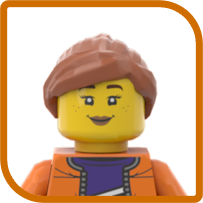

<!--
author:   Dr. Asta von Schröder (DAI) (https://orcid.org/0009-0007-5852-771X) with Anna Lisa Schwartz (GFBio) (https://orcid.org/0000-0003-0391-3879) and Karolin Heinle (MfN)
email:    asta.vonschroeder@dainst.de, alschwartz@gfbio.org, 
version:  0.0.1
version: 1.0
language: en
narrator: English Female
comment: Searching for object-related research data. Part of the series "Research, reuse, and publication of object-related data according to the FAIR principles".
license: CC BY 4.0

link:     https://cdn.jsdelivr.net/chartist.js/latest/chartist.min.css

link:     https://cdn.jsdelivr.net/gh/spaetzuenderin/WiNoDa_L2.4@438c55d/WiNoDa_LiaScript-Style.css

script:   https://cdn.jsdelivr.net/chartist.js/latest/chartist.min.js

@Anita: 

@0

@Dave: 

@0

@Kai: 

@0

@Susan: 

@0

@Winnie: 

@0

@AnitaH: 

@0

@DaveH: 

@0

@KaiH: 

@0

@SusanH: 

@0

@WinnieH: 

@0

@Anita_: 

@0

@Dave_: 

@0

@Kai_: 

@0

@Susan_: 

@0

@Winnie_: 

@0

@ExampleA

@0

@end

@ExampleB

@0

@end

@ExampleC

@0

@end

-->

# About this course

Welcome and thank you for taking this course on **Searching for object-related research data**.

This course is **part of our series "Research, reuse, and publication of object-related data according to the FAIR principles".**

You will learn how to

- evaluate the research data landscape,
- find object-related data created in archaeology and biodiversity research, as well as in natural history collections
- design and apply successful search strategies to find disciplinary, cross-disciplinary and open research data

**[PLATZHALTER: Estimated time: xx hour]**

<h3>OER</h3>
This course was created as Open Educational Resource (OER) and is published under a CC-BY licence.

In order to ensure optimal reusability, we tried to break down the content in modular self-contained units and chose a format that works both within and outside of classic Learning Management Systems (LMS, e.g. Moodle).

We also aimed at making the course engaging by including H5P interactive material throughout, bundling everything in one semantic unit within a H5P portfolio.

>[!NOTE]
>The course series **"Research, reuse, and publication of object-related data according to the FAIR principles"** consists of four parts. You can work through them in any order, but we advise you to begin with "Reusability and its relevance" followed by "Reusing object related research data". The other parts are:
>
>**Reusability and its relevance**
>Learn how to explain the concept of research data reuse, distinguish it from reproduction and replication, and understand why documentation is essential for data reuse.
>
>**Reusing object-related research data**
>Learn about practical requirements for reusing object-related data, such as legal permissions, ethical considerations, persistent identifiers and other Open Science practices.
>
>**Publishing object-related research data**
>Learn about data publication workflows for various domain-specific repositories, submission guidelines and curation support, as well as various tools to assist with publication.

*Quelle/Lizenz: U (laut H5P-Metadaten; in H5P steht „U“ für „undisclosed“, also nicht eindeutig lizenziert)*

<h3>Navigating the course</h3>

**Navigate directly to each portfolio chapter** by clicking on the chapter navigation on the left, or go back and forth between chapters using the arrows in the navigation bars above and below (highlighted in green).

**Note:** We do *not* recommend using the full screen mode - the responsive layout distorts certain proportions.

---

### Bilder in diesem Kapitel

| Dateiname | Alt-Text | Caption | Lizenz |
|---|---|---|---|
| images/file-69e2451a5836e.png | Screenshot of the portfolio with green highlights for the navigation items | Unbenannt: Image | U (undisclosed) |

---

### Hinweisliste

- **Platzhalter:** „Estimated time: xx hour“ (als [PLATZHALTER: Estimated time: xx hour] markiert). Autor und Narrator sind in der Quelle nicht angegeben und wurden als Platzhalter im Header gesetzt.
- **Fehlende Alt-Texte:** keine.
- **Unvollständige Texte:** keine.
- **Korrekturen:**
  - „Your will learn how to“ → „You will learn how to“
  - „Open Educational Ressource“ → „Open Educational Resource“
- **Unklare Zuordnungen:**
  - Bild-Caption „Unbenannt: Image“ ist ein H5P-Standardtitel und sollte geprüft werden.
  - Die Lizenz „U“ ist nicht eindeutig. Bitte die tatsächliche Lizenz des Screenshots klären.
- **Randomisierung:** nicht zutreffend, da keine Quizze in diesem Kapitel vorhanden sind.
